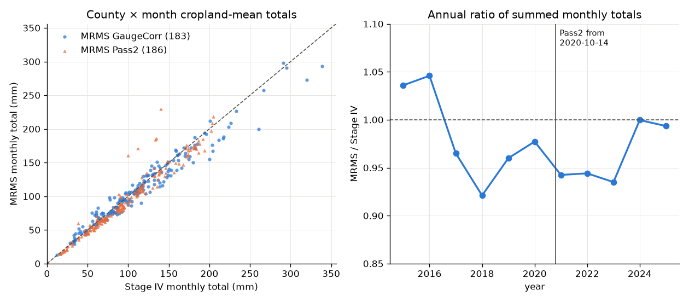

# Radar rainfall metrics per county × month (Stage IV, MRMS)

Made by `archive/scripts/rain_compare.py` on 2026-10-03 from `data/precip/rain_county_month.csv` (`archive/scripts/rain_metrics.py`) and the hourly clips from `scripts/fetch_precip_hourly.py`.

**Bottom line.**

- Stage IV hourly is complete for 2002–2025 from IEM; cropland-weighted, 51 of 864 county-months miss more than 2 % after filling absent hourly fields from the 6-h files (0.9% of cell-hours filled overall, most in 2003–2005).
- MRMS monthly totals are 3.2% below Stage IV in the GaugeCorr era (r 0.979) and 2.7% below in the Pass2 era (r 0.966): **no step at the 2020-10 switch** in totals. Hourly maxima agree less well under Pass2, and two MRMS radar artifacts (Dec 2020, Aug 2024) inflate those months (§3).
- Peak-cell 1 h maxima are ~15–20 % higher in MRMS: 1 km cells against Stage IV's ~4.8 km, so the products' peak-cell metrics are not interchangeable; cropland-mean metrics are.
- Recommendation for A4: Stage IV for 2003–2022 (one homogeneous product); MRMS as a check and for 1 km peak intensity.

## 1. Sources

| product | source | worked? |
|---|---|---|
| Stage IV hourly + 6-h, 2002 → | Iowa Environmental Mesonet `mesonet.agron.iastate.edu/archive/data/YYYY/MM/DD/stage4/ST4.YYYYMMDDHH.01h.grib` (`.06h.grib`) | yes, every year; GRIB1 to ~2019, GRIB2 after, same 1121 × 881 HRAP grid |
| Stage IV | Iowa State `mtarchive.geol.iastate.edu/YYYY/MM/DD/stage4/` | **no** (404; mtarchive has no stage4) |
| Stage IV | NCAR EOL ds21.093 / RDA ds507.5 | not tried (IEM was enough) |
| MRMS GaugeCorr_QPE_01H | Iowa State mtarchive | 2015-05-06T20 → 2020-10-14T12 |
| MRMS MultiSensor_QPE_01H_Pass2 | AWS `noaa-mrms-pds` | from **2020-10-14T20** (not 00Z) |
| MRMS MultiSensor_QPE_01H_Pass2 | Iowa State mtarchive | from 2020-10-13T19: fills the 8 h between the two |

- Both: the file time is the END of the hour (checked against the GRIB validity time for Stage IV and the reference time for MRMS, which MRMS stamps at the hour's end). Units mm (kg m⁻²). Missing → NaN (Stage IV bitmap; MRMS −3 = no coverage).
- Clip: `fetch_mrms.BBOX` (−75.64…−74.80 E, 38.98…39.94 N), which holds all three WHOLE counties incl. Gloucester's Great Egg Harbor part. MRMS 96 × 84 cells of 0.01°; Stage IV 34 × 31 HRAP cells (~4.76 km). The MRMS clip reproduces `data/precip/mrms_2023-09.nc` exactly.
- Weighting as `fetch_nwm_soil.py`: 30 m CDL cropland pixels binned to the cell holding their centre; CDL of the year (2008 for 2002–07, 2009 for 2010). Months and days are **America/New_York local**; an hour belongs to the local day holding its start.

## 2. Coverage

Files per year (`absent` = 404; `unreadable` = bad GRIB or wrong time/grid):

| year | mrms absent | stage4 absent | stage4_6h absent |
|---|---|---|---|
| 2002 | – | 0 | 483 |
| 2003 | – | 14 | 3 |
| 2004 | – | 7 | 0 |
| 2005 | – | 0 | 1 |
| 2006 | – | 0 | 1340 |
| 2007 | – | 0 | 2 |
| 2008 | – | 24 | 4 |
| 2009 | – | 9 | 1033 |
| 2010 | – | 0 | 0 |
| 2011 | – | 0 | 0 |
| 2012 | – | 0 | 0 |
| 2013 | – | 0 | 0 |
| 2014 | – | 0 | 0 |
| 2015 | 45 | 0 | 0 |
| 2016 | 31 | 0 | 2 |
| 2017 | 10 | 1 | 2 |
| 2018 | 16 | 0 | 4 |
| 2019 | 7 | 0 | 3 |
| 2020 | 3 | 0 | 8 |
| 2021 | 15 | 0 | 1 |
| 2022 | 19 | 0 | 9 |
| 2023 | 6 | 0 | 3 |
| 2024 | 3 | 0 | 3 |
| 2025 | 0 | 0 | 0 |

Unreadable files: 4.

Cropland-weighted share of cell-hours missing after the 6-h fill, and the share filled from Stage IV 6-h files (mean over county-months; worst county-month):

| year | mrms missing_frac | stage4 missing_frac | mrms filled_frac | stage4 filled_frac | mrms worst_month_missing | stage4 worst_month_missing |
|---|---|---|---|---|---|---|
| 2002 | – | 0.4 | – | 0.6 | – | 3.3 |
| 2003 | – | 0.3 | – | 4.2 | – | 2.4 |
| 2004 | – | 2.0 | – | 2.2 | – | 6.0 |
| 2005 | – | 2.6 | – | 8.2 | – | 11.6 |
| 2006 | – | 0.4 | – | 0.0 | – | 3.3 |
| 2007 | – | 1.1 | – | 0.4 | – | 9.0 |
| 2008 | – | 0.5 | – | 0.1 | – | 4.2 |
| 2009 | – | 0.4 | – | 0.0 | – | 2.8 |
| 2010 | – | 0.0 | – | 0.0 | – | 0.0 |
| 2011 | – | 0.0 | – | 0.0 | – | 0.0 |
| 2012 | – | 0.0 | – | 0.1 | – | 0.5 |
| 2013 | – | 0.1 | – | 0.1 | – | 1.4 |
| 2014 | – | 0.0 | – | 0.0 | – | 0.1 |
| 2015 | 2.7 | 0.1 | 0.0 | 3.4 | 18.6 | 0.5 |
| 2016 | 0.4 | 0.3 | 0.0 | 2.2 | 1.7 | 3.9 |
| 2017 | 0.1 | 0.0 | 0.0 | 0.0 | 0.5 | 0.0 |
| 2018 | 0.2 | 0.2 | 0.0 | 0.1 | 1.9 | 2.2 |
| 2019 | 0.1 | 0.0 | 0.0 | 0.1 | 0.7 | 0.0 |
| 2020 | 0.0 | 0.0 | 0.0 | 0.0 | 0.1 | 0.0 |
| 2021 | 0.2 | 0.0 | 0.0 | 0.0 | 0.6 | 0.0 |
| 2022 | 0.2 | 0.0 | 0.0 | 0.0 | 1.0 | 0.0 |
| 2023 | 0.1 | 0.0 | 0.0 | 0.0 | 0.4 | 0.0 |
| 2024 | 0.0 | 0.0 | 0.0 | 0.0 | 0.4 | 0.0 |
| 2025 | 0.1 | 0.1 | 0.0 | 0.0 | 0.7 | 0.7 |

(Percent.) The Stage IV HOURLY mosaic has whole hours with no data over NJ although the file exists (MARFC's hourly field absent), mostly in the early years; the 6-h files are complete there. Each missing hour gets an even share of the 6-h total minus the hours present, so totals are right and peak intensities in those hours are smoothed: use `filled_frac` to screen intensity metrics.

Stage IV months still missing > 5 % on some county's cropland (where the 6-h files are blank or absent too; IEM has no 6-h files for 2006 or 2009-01..09): 2004-02 (6%), 2005-02 (12%), 2005-07 (6%), 2005-12 (10%), 2007-07 (9%).

### Stage IV hourly vs 6-h over complete 6-h windows

| year | complete_window_frac | missing_hour_frac | hourly_mm | six_hour_mm | ratio |
|---|---|---|---|---|---|
| 2002 | 0.6534 | 0.01062 | 740.9 | 734.1 | 1.009 |
| 2003 | 0.9164 | 0.04578 | 1143 | 1158 | 0.9869 |
| 2004 | 0.9003 | 0.04076 | 1037 | 1040 | 0.9975 |
| 2005 | 0.8671 | 0.1057 | 946.4 | 947.6 | 0.9987 |
| 2006 | 0.08151 | 0.00411 | 94.26 | 94.06 | 1.002 |
| 2007 | 0.9699 | 0.0153 | 1081 | 1083 | 0.9982 |
| 2008 | 0.987 | 0.005578 | 1112 | 1114 | 0.9978 |
| 2009 | 0.2856 | 0.003881 | 510.2 | 510.5 | 0.9995 |
| 2010 | 1 | 0 | 1222 | 1224 | 0.9981 |
| 2011 | 0.9904 | 0.0001142 | 1550 | 1552 | 0.9984 |
| 2012 | 0.9884 | 0.001025 | 963.2 | 936.3 | 1.029 |
| 2013 | 0.974 | 0.001826 | 1154 | 1144 | 1.009 |
| 2014 | 0.9918 | 0.0004566 | 1318 | 1319 | 0.9993 |
| 2015 | 0.9452 | 0.03447 | 1289 | 1295 | 0.9957 |
| 2016 | 0.9583 | 0.02505 | 1020 | 1022 | 0.9983 |
| 2017 | 0.9966 | 0.0003425 | 1203 | 1205 | 0.9988 |
| 2018 | 0.9932 | 0.00274 | 1677 | 1680 | 0.9987 |
| 2019 | 0.9966 | 0.001256 | 1224 | 1224 | 1 |
| 2020 | 0.9932 | 0.0002277 | 1557 | 1559 | 0.9991 |
| 2021 | 0.9993 | 0 | 1092 | 1095 | 0.9973 |
| 2022 | 0.9932 | 0.0001142 | 1171 | 1172 | 0.9987 |
| 2023 | 0.9979 | 0 | 1185 | 1187 | 0.9982 |
| 2024 | 0.998 | 0 | 1037 | 1040 | 0.9972 |
| 2025 | 1 | 0 | 1037 | 1040 | 0.9972 |

Hourly sums are 1.000 × the 6-h totals over 6-h windows where all six hours exist (all years, cropland-weighted).

## 3. Stage IV vs MRMS

County × month pairs with < 2% missing in both; MRMS is the test, Stage IV the reference. bias = mean(MRMS − Stage IV); se its standard error.

| metric | MRMS period | n | r | mean_ref_mm | mean_test_mm | bias_mm | bias_se_mm | ratio_of_sums | median_ratio |
|---|---|---|---|---|---|---|---|---|---|
| total_mm | GaugeCorr | 183 | 0.979 | 115.211 | 111.498 | -3.713 | 0.943 | 0.968 | 0.982 |
| total_mm | Pass2 | 186 | 0.966 | 93.960 | 91.412 | -2.548 | 0.941 | 0.973 | 0.944 |
| max1h_mm | GaugeCorr | 183 | 0.889 | 10.303 | 9.758 | -0.546 | 0.223 | 0.947 | 0.907 |
| max1h_mm | Pass2 | 186 | 0.694 | 9.607 | 10.071 | 0.464 | 0.450 | 1.048 | 0.937 |
| max24h_mm | GaugeCorr | 183 | 0.959 | 38.898 | 37.202 | -1.696 | 0.424 | 0.956 | 0.960 |
| max24h_mm | Pass2 | 186 | 0.881 | 34.064 | 33.889 | -0.176 | 0.723 | 0.995 | 0.957 |
| peakcell_max1h_mm | GaugeCorr | 183 | 0.871 | 26.036 | 30.540 | 4.504 | 0.800 | 1.173 | 1.131 |
| peakcell_max1h_mm | Pass2 | 186 | 0.753 | 23.698 | 28.217 | 4.519 | 0.992 | 1.191 | 1.092 |
| wetdays_1mm | GaugeCorr | 183 | 0.942 | 9.967 | 10.355 | 0.388 | 0.083 | 1.039 | 1.000 |
| wetdays_1mm | Pass2 | 186 | 0.971 | 8.828 | 8.645 | -0.183 | 0.051 | 0.979 | 1.000 |
| ante30d_mm | GaugeCorr | 183 | 0.981 | 109.192 | 107.140 | -3.297 | 0.915 | 0.965 | 0.981 |
| ante30d_mm | Pass2 | 186 | 0.964 | 92.441 | 89.876 | -2.565 | 0.941 | 0.972 | 0.944 |

Monthly totals by county:

| period | county | n | r | bias_mm | ratio_of_sums |
|---|---|---|---|---|---|
| GaugeCorr | Cumberland | 61 | 0.973 | -2.072 | 0.982 |
| GaugeCorr | Gloucester | 61 | 0.984 | -4.069 | 0.965 |
| GaugeCorr | Salem | 61 | 0.981 | -4.998 | 0.957 |
| Pass2 | Cumberland | 62 | 0.969 | -1.105 | 0.988 |
| Pass2 | Gloucester | 62 | 0.980 | -4.463 | 0.954 |
| Pass2 | Salem | 62 | 0.950 | -2.075 | 0.978 |

Annual ratio of summed monthly totals (all three counties):

| year | MRMS / Stage IV |
|---|---|
| 2015 | 1.036 |
| 2016 | 1.046 |
| 2017 | 0.965 |
| 2018 | 0.921 |
| 2019 | 0.960 |
| 2020 | 0.977 |
| 2021 | 0.942 |
| 2022 | 0.944 |
| 2023 | 0.935 |
| 2024 | 1.000 |
| 2025 | 0.993 |

Daily county cropland means agree at r = 0.977 (11,679 county-days). Days differing by more than 30 mm (all are MRMS too high; MRMS Pass1 and RadarOnly carry the same values, so these are radar artifacts the gauge correction left in, which Stage IV's RFC QC removed — 2020-12-25 01–03Z: 44 and 35 mm/h over the whole clip against Stage IV 6–8; 2024-08-30 04–05Z: 14 mm/h against 1.5). Prefer Stage IV in those months:

| county | date | mrms | stage4 | MRMS − Stage IV |
|---|---|---|---|---|
| Salem | 2024-08-29 | 48.1 | 11.9 | 36.2 |
| Cumberland | 2024-08-30 | 54.6 | 12.2 | 42.4 |
| Gloucester | 2020-12-24 | 77.3 | 33.8 | 43.5 |
| Cumberland | 2020-12-24 | 82.6 | 30.8 | 51.8 |
| Salem | 2020-12-24 | 119.3 | 36.4 | 82.9 |

## 4. Against NWM `qrain_mm` (indicative)

NWM v3.0 retrospective rain (AORC-forced; daily mean of 3-hourly rates, so only indicative), summed by calendar month and compared with the monthly totals here (radar = test, NWM = reference), to 2023-01. **`qrain` is LIQUID rain only** (snow is `QSNOW`), so winter radar totals (liquid equivalent of all precipitation) run 30-90 % above it; Apr-Oct is the fair comparison.

| product | months | n | r | mean_ref_mm | mean_test_mm | bias_mm | bias_se_mm | ratio_of_sums | median_ratio | years |
|---|---|---|---|---|---|---|---|---|---|---|
| stage4 | all months | 708 | 0.895 | 95.260 | 104.030 | 8.770 | 1.043 | 1.092 | 1.081 | 2002-2023 |
| stage4 | Apr-Oct | 414 | 0.941 | 112.270 | 112.740 | 0.470 | 1.136 | 1.004 | 1.024 | 2002-2022 |
| mrms | all months | 273 | 0.868 | 101.493 | 105.559 | 4.066 | 1.725 | 1.040 | 1.023 | 2015-2023 |
| mrms | Apr-Oct | 159 | 0.923 | 122.176 | 114.569 | -7.608 | 1.810 | 0.938 | 0.955 | 2015-2022 |

## 5. Headline numbers (Stage IV, cropland means unless 'peak cell')

Wettest county-months:

| county | year | month | total_mm | max24h_mm | max1h_mm | peakcell_max1h_mm | filled_frac |
|---|---|---|---|---|---|---|---|
| Salem | 2011 | 8 | 522.2 | 194.2 | 43.4 | 69.9 | 0.0 |
| Gloucester | 2011 | 8 | 505.6 | 179.0 | 37.6 | 67.6 | 0.0 |
| Cumberland | 2011 | 8 | 503.4 | 187.7 | 28.5 | 73.5 | 0.0 |
| Salem | 2020 | 8 | 339.1 | 112.3 | 29.9 | 79.6 | 0.0 |
| Gloucester | 2020 | 8 | 320.1 | 111.4 | 43.9 | 77.0 | 0.0 |
| Salem | 2013 | 6 | 303.2 | 83.0 | 15.2 | 38.2 | 0.0 |
| Salem | 2015 | 6 | 294.9 | 67.0 | 15.3 | 33.5 | 0.0 |
| Cumberland | 2015 | 6 | 291.0 | 78.6 | 19.3 | 70.9 | 0.0 |

Largest cropland-mean 1 h rates:

| county | year | month | total_mm | max24h_mm | max1h_mm | peakcell_max1h_mm | filled_frac |
|---|---|---|---|---|---|---|---|
| Gloucester | 2020 | 8 | 320.1 | 111.4 | 43.9 | 77.0 | 0.0 |
| Salem | 2011 | 8 | 522.2 | 194.2 | 43.4 | 69.9 | 0.0 |
| Cumberland | 2017 | 7 | 217.6 | 60.3 | 38.8 | 56.5 | 0.0 |
| Gloucester | 2011 | 8 | 505.6 | 179.0 | 37.6 | 67.6 | 0.0 |
| Cumberland | 2014 | 8 | 153.9 | 106.8 | 34.3 | 105.8 | 0.0 |
| Cumberland | 2025 | 7 | 204.6 | 63.8 | 31.3 | 54.1 | 0.0 |

Largest cropland-mean 24 h totals:

| county | year | month | total_mm | max24h_mm | max1h_mm | peakcell_max1h_mm | filled_frac |
|---|---|---|---|---|---|---|---|
| Salem | 2011 | 8 | 522.2 | 194.2 | 43.4 | 69.9 | 0.0 |
| Cumberland | 2011 | 8 | 503.4 | 187.7 | 28.5 | 73.5 | 0.0 |
| Gloucester | 2011 | 8 | 505.6 | 179.0 | 37.6 | 67.6 | 0.0 |
| Gloucester | 2005 | 10 | 237.6 | 126.4 | 19.0 | 39.4 | 0.0 |
| Salem | 2005 | 10 | 211.6 | 125.3 | 19.3 | 28.8 | 0.0 |
| Gloucester | 2007 | 4 | 239.8 | 118.0 | 10.4 | 16.9 | 0.0 |

Largest single-cell hour on cropland, per product:

| product | county | year | month | total_mm | max24h_mm | max1h_mm | peakcell_max1h_mm | filled_frac |
|---|---|---|---|---|---|---|---|---|
| mrms | Salem | 2024 | 8 | 171.1 | 75.4 | 45.4 | 138.5 | 0.0 |
| stage4 | Cumberland | 2014 | 8 | 153.9 | 106.8 | 34.3 | 105.8 | 0.0 |

The two flagged months:

| product | county | year | month | total_mm | max24h_mm | max1h_mm | peakcell_max1h_mm | filled_frac | ante30d_mm | frac_crop_24h_ge50 |
|---|---|---|---|---|---|---|---|---|---|---|
| mrms | Cumberland | 2023 | 9 | 172.00 | 50.29 | 30.19 | 74.20 | 0.00 | 71.63 | 0.59 |
| mrms | Salem | 2025 | 5 | 169.00 | 32.29 | 17.78 | 43.70 | 0.00 | 87.49 | 0.01 |
| stage4 | Cumberland | 2023 | 9 | 181.90 | 53.52 | 28.89 | 72.00 | 0.00 | 78.72 | 0.60 |
| stage4 | Salem | 2025 | 5 | 176.70 | 32.07 | 19.35 | 38.00 | 0.00 | 90.50 | 0.00 |
