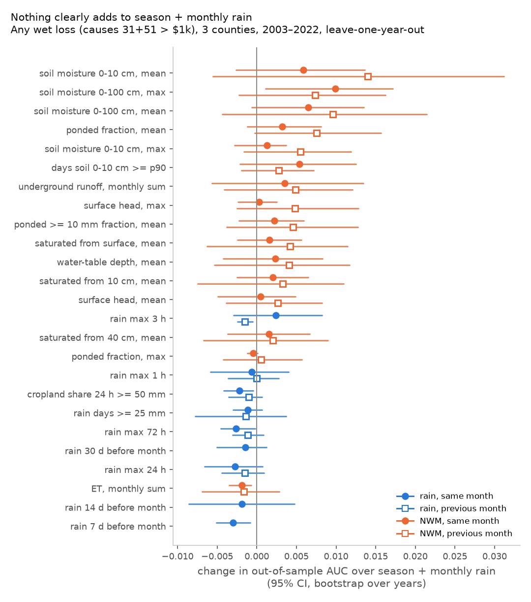
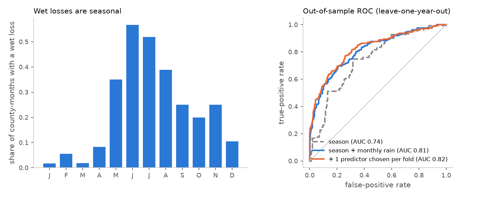

# A4 first test: do cheap wetness predictors beat season + monthly rain?

Made by `scripts/a4_first_test.py` from the RMA loss panel (`data/rma/`), Stage IV rain (`data/precip/`) and the NWM v3.0 retrospective (`data/nwm/`). Tables: `data/analysis/a4_*.csv`. The collaborators' file in `data/insurance/` is not read.

**Bottom line.**

- **Season does most of the work; monthly rain adds a clear second step.** Any wet loss (causes 31 + 51 > $1k, all crops), 690 county-months 2003–2022 (162 with a loss), leave-one-year-out AUC: season alone (calendar month + county) 0.742; + this month's rain 0.799; **+ this and last month's rain 0.809** (the baseline B, +0.067 [+0.022, +0.104] over season; 95% CIs from a bootstrap over years).
- **Nothing beats season + monthly rain by a margin distinguishable from zero.** Choosing the extra predictor inside each training fold (the honest number), one added predictor gains +0.014 [-0.005, +0.032] AUC and three gain +0.002 [-0.016, +0.022]: more predictors overfit at ~162 positives. The one test fixed in advance (NWM 0–10 cm soil-moisture anomaly, same month; FINDINGS §8) gives +0.006 [-0.003, +0.014].
- **The only consistent extra signal is NWM soil moisture,** worth about +0.01 to +0.02 AUC, roughly a fifth of what rain adds over season. The fold-wise selection picks soil moisture 0-10 cm, mean (previous month) 20/20. The best single additions are soil moisture 0-10 cm, mean (previous month) +0.014 [-0.006, +0.031] and the same-month 0–100 cm maximum +0.010 [+0.001, +0.017]. Only 1 of 47 additions has a CI above zero (~1.2 expected by chance), so this is a lead, not a result. Under the broad water definition the 0–100 cm maximum gives +0.017 [+0.003, +0.031]. Used *instead of* rain, the best NWM state (soil moisture 0-100 cm, max, both lags) scores 0.820 against 0.809 for B (+0.011 [-0.005, +0.030]). Soil moisture can stand in for monthly rain, and is no worse.
- **Rain intensity adds nothing over the monthly total.** Max 1/3/24/72 h, days ≥ 25 mm, cropland share ≥ 50 mm in 24 h and the 7/14/30-day antecedent totals each change AUC by -0.003 to +0.002. Every one is worse than the monthly total when used in its place. At county × month, these losses do not respond to sub-daily intensity.
- **Lag:** for rain, the same month matters most (adding last month's rain moves AUC 0.799 → 0.809). For soil moisture, the previous month is the most consistent pick. That fits a slow storage signal, and losses recorded at harvest after the damage. By crop, corn's pick is the previous month; soybeans' and wheat's are the same month.
- **By crop** (tables 4–5): no crop shows a gain distinguishable from zero after selection: soybeans +0.008 [-0.004, +0.025], wheat +0.011 [-0.022, +0.050], corn +0.004 [-0.010, +0.017]. Even so, each crop picks one soil-moisture variable in 19 of 20 folds. Rain helps corn and soybeans (B over S ≈ +0.06) much more than wheat (+0.026 [-0.023, +0.069]).
- **Loss size, given a loss occurred, is not predicted** by anything here (out-of-sample Spearman ≤ ~0.15; table 6). In single-policy cells the dollar size is mostly farm-specific.
- **For SFINCS (Track B):** the bar is AUC ≈ 0.81 (season + monthly rain). The predictor that comes closest to clearing it is a soil-storage state, not rain intensity. SFINCS features should be scored the same way: against B, and against B + NWM soil moisture.

## 1. Design

- **Cells:** 3 counties × 2003–2022 × 12 months = 720; 30 dropped because Stage IV misses > 5% of a county's cropland in that month or the one before (2004-02, 2005-02, 2005-07, 2005-12, 2007-07 and their following months).
- **Targets:** any wet indemnity > $1k (lead) or > $0, under causes 31 + 51 (lead) or the broad water set (`reports/loss_panel.md`); crop group "all" for county × month (binary, so the 2014 "other" liability break does not matter), and corn, soybeans, wheat separately. Continuous: log10 wet indemnity and the corn + soy + wheat wet loss ratio, among loss months.
- **Predictors:** Stage IV cropland-mean rain metrics and NWM daily cropland-weighted states aggregated to the month (list in the script docstring), for the same and the previous month. In models they enter as normal-score anomalies within county × calendar month, so the season is handled only by the dummies. Max 1/3 h are blanked where > 5% of the month's cropland hours were spread from 6-h files (Jun–Jul 2003, Jan–Apr 2005, Oct 2015–Feb 2016, Feb 2004).
- **Models:** ridge logistic (λ = 1, standardized on training years). S = month + county dummies. B = S + log(1 + Stage IV monthly total) this month and last month: the strongest of the simple rain baselines tried (table 2; an exposure term, log liability, made both S and B worse out of sample). B + X adds one predictor; S + X puts X (both lags) in place of rain. Selection-aware: forward selection of 1 or 3 predictors from all 47 by training log-likelihood, redone inside each of the 20 leave-one-year-out folds (missing anomalies set to 0, the median).
- **Scores:** pooled out-of-fold AUC and Brier; CIs from 2000 bootstrap draws of whole years over the out-of-fold predictions (the models are not refitted per draw, so CIs are somewhat narrow). `p_boot` = share of draws with no gain.

## 2. Baselines (county × month)

| target | model | n_pos | auc | brier | vs S |
|---|---|---|---|---|---|
| y_3151_1k | S = season (month + county) | 162 | 0.742 | 0.153 |  |
| y_3151_1k | S + log rain this month | 162 | 0.799 | 0.135 | +0.057 [+0.018, +0.090] |
| y_3151_1k | B = S + log rain this + last month | 162 | 0.809 | 0.132 | +0.067 [+0.022, +0.104] |
| y_3151_1k | S + rain anomaly this + last month | 162 | 0.806 | 0.134 | +0.064 [+0.021, +0.101] |
| y_3151_1k | S + log liability (exposure) | 162 | 0.730 | 0.158 | -0.012 [-0.049, +0.011] |
| y_3151_1k | B + log liability (exposure) | 162 | 0.796 | 0.136 | +0.054 [-0.003, +0.100] |
| y_3151_0 | S = season (month + county) | 180 | 0.759 | 0.157 |  |
| y_3151_0 | S + log rain this month | 180 | 0.819 | 0.137 | +0.059 [+0.024, +0.091] |
| y_3151_0 | B = S + log rain this + last month | 180 | 0.827 | 0.134 | +0.067 [+0.028, +0.103] |
| y_3151_0 | S + rain anomaly this + last month | 180 | 0.820 | 0.137 | +0.060 [+0.025, +0.093] |
| y_3151_0 | S + log liability (exposure) | 180 | 0.751 | 0.161 | -0.008 [-0.026, +0.003] |
| y_3151_0 | B + log liability (exposure) | 180 | 0.818 | 0.137 | +0.059 [+0.015, +0.098] |
| y_broad_1k | S = season (month + county) | 192 | 0.667 | 0.183 |  |
| y_broad_1k | S + log rain this month | 192 | 0.756 | 0.161 | +0.089 [+0.051, +0.117] |
| y_broad_1k | B = S + log rain this + last month | 192 | 0.775 | 0.156 | +0.107 [+0.059, +0.144] |
| y_broad_1k | S + rain anomaly this + last month | 192 | 0.773 | 0.160 | +0.105 [+0.055, +0.142] |
| y_broad_1k | S + log liability (exposure) | 192 | 0.668 | 0.186 | +0.001 [-0.051, +0.036] |
| y_broad_1k | B + log liability (exposure) | 192 | 0.765 | 0.159 | +0.097 [+0.024, +0.149] |
| y_broad_0 | S = season (month + county) | 212 | 0.692 | 0.188 |  |
| y_broad_0 | S + log rain this month | 212 | 0.778 | 0.162 | +0.087 [+0.047, +0.119] |
| y_broad_0 | B = S + log rain this + last month | 212 | 0.795 | 0.158 | +0.103 [+0.056, +0.141] |
| y_broad_0 | S + rain anomaly this + last month | 212 | 0.791 | 0.161 | +0.100 [+0.053, +0.138] |
| y_broad_0 | S + log liability (exposure) | 212 | 0.688 | 0.192 | -0.003 [-0.036, +0.020] |
| y_broad_0 | B + log liability (exposure) | 212 | 0.787 | 0.161 | +0.096 [+0.036, +0.143] |

## 2b. Each predictor alone (no fitting; lead target)

`auc_raw` keeps the seasonal cycle; `auc_anom` is the anomaly within county × calendar month (season removed). The 8 best anomalies, and the rain total. ET is scored with low ET = wet; its AUC < 0.5 means the opposite holds.

| predictor | family | auc_raw | auc_anom |
|---|---|---|---|
| soil moisture 0-100 cm, max (same month) | NWM | 0.624 | 0.706 |
| soil moisture 0-10 cm, mean (same month) | NWM | 0.521 | 0.696 |
| ponded fraction, mean (same month) | NWM | 0.637 | 0.694 |
| ponded >= 10 mm fraction, mean (same month) | NWM | 0.606 | 0.691 |
| soil moisture 0-100 cm, mean (same month) | NWM | 0.546 | 0.691 |
| surface head, mean (same month) | NWM | 0.573 | 0.690 |
| underground runoff, monthly sum (same month) | NWM | 0.514 | 0.689 |
| saturated from 10 cm, mean (same month) | NWM | 0.549 | 0.688 |
| rain total (same month) | rain | 0.702 | 0.663 |
| rain total (previous month) | rain | 0.603 | 0.572 |

## 3. One predictor added to B (county × month)

Lead target (31 + 51 > $1k), the 12 largest gains and every rain-intensity row. `auc S+X` = X in place of rain (lag 0 rows only).

| predictor | n | n_pos | auc_BX | ΔAUC [95% CI] | p_boot | dbrier | auc_SX |
|---|---|---|---|---|---|---|---|
| soil moisture 0-10 cm, mean (previous month) | 690 | 162 | 0.823 | +0.014 [-0.006, +0.031] | 0.074 | -0.005 | nan |
| soil moisture 0-100 cm, max (same month) | 690 | 162 | 0.819 | +0.010 [+0.001, +0.017] | 0.015 | -0.003 | 0.820 |
| soil moisture 0-100 cm, mean (previous month) | 690 | 162 | 0.819 | +0.010 [-0.004, +0.021] | 0.075 | -0.003 | nan |
| ponded fraction, mean (previous month) | 690 | 162 | 0.817 | +0.008 [-0.000, +0.016] | 0.031 | -0.002 | nan |
| soil moisture 0-100 cm, max (previous month) | 690 | 162 | 0.817 | +0.007 [-0.002, +0.016] | 0.069 | -0.002 | nan |
| soil moisture 0-100 cm, mean (same month) | 690 | 162 | 0.816 | +0.006 [-0.001, +0.013] | 0.036 | -0.002 | 0.809 |
| soil moisture 0-10 cm, mean (same month) | 690 | 162 | 0.815 | +0.006 [-0.003, +0.014] | 0.102 | -0.002 | 0.816 |
| soil moisture 0-10 cm, max (previous month) | 690 | 162 | 0.815 | +0.005 [-0.002, +0.012] | 0.062 | -0.002 | nan |
| days soil 0-10 cm >= p90 (same month) | 690 | 162 | 0.815 | +0.005 [-0.002, +0.013] | 0.086 | -0.002 | 0.811 |
| underground runoff, monthly sum (previous month) | 690 | 162 | 0.814 | +0.005 [-0.004, +0.012] | 0.128 | -0.002 | nan |
| surface head, max (previous month) | 690 | 162 | 0.814 | +0.005 [-0.002, +0.013] | 0.099 | -0.001 | nan |
| ponded >= 10 mm fraction, mean (previous month) | 690 | 162 | 0.814 | +0.005 [-0.004, +0.013] | 0.158 | -0.001 | nan |
| rain max 3 h (same month) | 663 | 157 | 0.804 | +0.002 [-0.003, +0.008] | 0.202 | -0.001 | 0.756 |
| rain max 1 h (previous month) | 663 | 158 | 0.807 | +0.000 [-0.004, +0.003] | 0.532 | 0.000 | nan |
| rain max 1 h (same month) | 663 | 157 | 0.801 | -0.001 [-0.006, +0.004] | 0.592 | 0.000 | 0.752 |
| cropland share 24 h >= 50 mm (previous month) | 690 | 162 | 0.808 | -0.001 [-0.004, +0.001] | 0.878 | 0.000 | nan |
| rain days >= 25 mm (same month) | 690 | 162 | 0.808 | -0.001 [-0.003, +0.001] | 0.906 | 0.000 | 0.776 |
| rain max 72 h (previous month) | 690 | 162 | 0.808 | -0.001 [-0.003, +0.001] | 0.898 | 0.001 | nan |
| rain days >= 25 mm (previous month) | 690 | 162 | 0.808 | -0.001 [-0.008, +0.004] | 0.683 | -0.000 | nan |
| rain 30 d before month (same month) | 690 | 162 | 0.808 | -0.001 [-0.005, +0.001] | 0.851 | 0.001 | 0.761 |
| rain max 3 h (previous month) | 663 | 158 | 0.805 | -0.001 [-0.002, -0.001] | 0.998 | 0.000 | nan |
| rain max 24 h (previous month) | 690 | 162 | 0.808 | -0.002 [-0.004, +0.001] | 0.892 | 0.000 | nan |
| rain 14 d before month (same month) | 690 | 162 | 0.808 | -0.002 [-0.009, +0.005] | 0.707 | 0.001 | 0.755 |
| cropland share 24 h >= 50 mm (same month) | 690 | 162 | 0.807 | -0.002 [-0.004, -0.000] | 0.996 | 0.000 | 0.775 |
| rain max 72 h (same month) | 690 | 162 | 0.807 | -0.003 [-0.005, -0.000] | 0.985 | 0.001 | 0.791 |
| rain max 24 h (same month) | 690 | 162 | 0.807 | -0.003 [-0.007, +0.001] | 0.939 | 0.001 | 0.776 |
| rain 7 d before month (same month) | 690 | 162 | 0.806 | -0.003 [-0.005, -0.001] | 0.998 | 0.001 | 0.748 |

Best addition under each target definition:

| target | n_pos | auc_B | predictor | ΔAUC [95% CI] | n_ci_above_0 |
|---|---|---|---|---|---|
| y_3151_0 | 180 | 0.827 | soil moisture 0-100 cm, max (same month) | +0.009 [+0.001, +0.017] | 1 |
| y_3151_0 | 180 | 0.827 | soil moisture 0-10 cm, mean (previous month) | +0.008 [-0.008, +0.022] | 1 |
| y_3151_1k | 162 | 0.809 | soil moisture 0-10 cm, mean (previous month) | +0.014 [-0.006, +0.031] | 1 |
| y_3151_1k | 162 | 0.809 | soil moisture 0-100 cm, max (same month) | +0.010 [+0.001, +0.017] | 1 |
| y_broad_0 | 212 | 0.795 | soil moisture 0-100 cm, max (same month) | +0.016 [+0.003, +0.029] | 1 |
| y_broad_0 | 212 | 0.795 | soil moisture 0-10 cm, mean (same month) | +0.010 [-0.002, +0.022] | 1 |
| y_broad_1k | 192 | 0.775 | soil moisture 0-100 cm, max (same month) | +0.017 [+0.003, +0.031] | 1 |
| y_broad_1k | 192 | 0.775 | soil moisture 0-10 cm, mean (previous month) | +0.014 [-0.003, +0.031] | 1 |

## 4. By crop (31 + 51 > $1k)

| crop | n | n_pos | auc_S | auc_B | B vs S | auc_S_expo | auc_B_expo |
|---|---|---|---|---|---|---|---|
| corn | 690 | 71 | 0.770 | 0.832 | +0.062 [-0.006, +0.122] | 0.731 | 0.803 |
| soybeans | 690 | 89 | 0.800 | 0.861 | +0.061 [+0.018, +0.104] | 0.776 | 0.842 |
| wheat | 690 | 51 | 0.744 | 0.770 | +0.026 [-0.023, +0.069] | 0.748 | 0.770 |

(`_expo`: with the crop's log liability as an exposure term; sensitivity only.)

Top three single additions to B per crop:

| cut | predictor | auc_BX | ΔAUC [95% CI] | p_boot |
|---|---|---|---|---|
| wheat | days soil 0-10 cm >= p90 (same month) | 0.794 | +0.024 [-0.007, +0.058] | 0.067 |
| wheat | soil moisture 0-100 cm, max (same month) | 0.788 | +0.017 [-0.003, +0.037] | 0.046 |
| soybeans | soil moisture 0-100 cm, max (same month) | 0.873 | +0.012 [-0.000, +0.027] | 0.029 |
| wheat | surface head, mean (same month) | 0.781 | +0.012 [-0.008, +0.030] | 0.121 |
| corn | soil moisture 0-10 cm, mean (previous month) | 0.842 | +0.010 [-0.004, +0.023] | 0.073 |
| soybeans | soil moisture 0-10 cm, mean (previous month) | 0.870 | +0.010 [-0.003, +0.025] | 0.075 |
| soybeans | soil moisture 0-10 cm, max (same month) | 0.870 | +0.009 [+0.000, +0.019] | 0.023 |
| corn | soil moisture 0-100 cm, mean (previous month) | 0.837 | +0.005 [-0.003, +0.013] | 0.090 |
| corn | underground runoff, monthly sum (previous month) | 0.837 | +0.005 [-0.003, +0.010] | 0.121 |

## 5. Selection-aware (predictors chosen inside each fold)

| cut | k | n_pos | auc_B | auc_SEL | ΔAUC [95% CI] | p_boot | dbrier | chosen (folds of 20) |
|---|---|---|---|---|---|---|---|---|
| county-month | 1 | 162 | 0.809 | 0.823 | +0.014 [-0.005, +0.032] | 0.070 | -0.005 | soil moisture 0-10 cm, mean (previous month) 20/20 |
| county-month | 3 | 162 | 0.809 | 0.812 | +0.002 [-0.016, +0.022] | 0.437 | -0.000 | soil moisture 0-10 cm, mean (previous month) 20/20, soil moisture 0-100 cm, max (same month) 15/20, saturated from 40 cm, mean (previous month) 10/20 |
| corn | 1 | 71 | 0.832 | 0.836 | +0.004 [-0.010, +0.017] | 0.310 | -0.000 | soil moisture 0-10 cm, mean (previous month) 19/20, ponded fraction, max (same month) 1/20 |
| soybeans | 1 | 89 | 0.861 | 0.869 | +0.008 [-0.004, +0.025] | 0.129 | -0.003 | soil moisture 0-100 cm, max (same month) 19/20, soil moisture 0-10 cm, mean (previous month) 1/20 |
| wheat | 1 | 51 | 0.770 | 0.781 | +0.011 [-0.022, +0.050] | 0.268 | -0.001 | days soil 0-10 cm >= p90 (same month) 19/20, rain max 3 h (same month) 1/20 |

## 6. Loss size among loss months (out-of-sample Spearman)

| target | model | n | rho | Δρ vs previous [95% CI] |
|---|---|---|---|---|
| log10 wet indemnity (all crops) | S | 180 | 0.033 |  |
| log10 wet indemnity (all crops) | B | 180 | 0.114 | +0.08 [-0.01, +0.16] |
| log10 wet indemnity (all crops) | B + rain max 1 h (same month) | 175 | 0.107 | +0.03 [-0.07, +0.13] |
| log10 wet indemnity (all crops) | B + saturated from surface, mean (same month) | 180 | 0.145 | +0.03 [-0.05, +0.10] |
| row-crop wet loss ratio | S | 153 | 0.093 |  |
| row-crop wet loss ratio | B | 153 | 0.035 | -0.06 [-0.14, +0.02] |
| row-crop wet loss ratio | B + rain max 1 h (same month) | 148 | 0.000 | +0.13 [-0.04, +0.25] |
| row-crop wet loss ratio | B + soil moisture 0-10 cm, mean (same month) | 153 | 0.122 | +0.09 [-0.02, +0.17] |

(Δρ: B vs S, and B + X vs B. The best X of 47 is shown, so its Δρ is optimistic.)

## 7. The two flagged months (descriptive; NWM ends 2023-01)

Percentiles: rank among the same county and calendar month, 2002–2025. `p_season`, `p_B`: probability of a wet loss > $1k from S and B fitted on all of 2003–2022.

| index | Cumberland 2023-09 | Salem 2025-05 |
|---|---|---|
| wet 31+51 $ | 351,003.00 | 66,502.58 |
| share of years with a loss | 0.30 | 0.60 |
| p_season | 0.19 | 0.44 |
| p_B | 0.33 | 0.72 |
| total_mm | 181.9 (94th pctl) | 176.7 (94th pctl) |
| total_mm_l1 | 78.7 (40th pctl) | 90.5 (48th pctl) |
| max1h_mm | 28.9 (98th pctl) | 19.4 (98th pctl) |
| max24h_mm | 53.5 (65th pctl) | 32.1 (52nd pctl) |
| max72h_mm | 96.7 (98th pctl) | 59.3 (85th pctl) |
| frac_crop_24h_ge50 | 0.60 (69th pctl) | 0.00 (33rd pctl) |
| ante14d_mm | 26.0 (31st pctl) | 4.6 (2nd pctl) |

Both months were in the top ~6% for their county-month rain total, with an ordinary previous month; B raises the loss probability over season alone in both. Neither is extreme in 24 h rain.

## 8. Caveats

- **Multiple comparisons.** 47 predictor × lag additions per target, 7 target/crop cuts and 4 water/threshold definitions. Single-test CIs above zero should be read against that; the selection-aware rows in §5 are the honest numbers.
- **Correlated tests.** The soil-moisture variables are strongly inter-correlated, so their consistent ranking is one signal seen several times, not several signals.
- **Anomaly climatologies** use every year, including the held-out one (predictor values only, never the target), so they are not strictly out-of-sample.
- **ET** carries the opposite sign to the a-priori one (higher ET anomaly with losses: wet soil evaporates more in this energy-limited climate).
- **Loss timing.** Month of loss is when the loss is recorded (often at harvest), not when water stood. This blurs the lag structure and favours slow storage variables over event intensity.
- **Binary targets** dodge the single-policy dollar noise and the 2014 "other" liability break; 31 + 51 is almost all cause 31 (excess moisture).
- **2003–2022 only** (NWM). Rain-only models could use 2003–2025.
