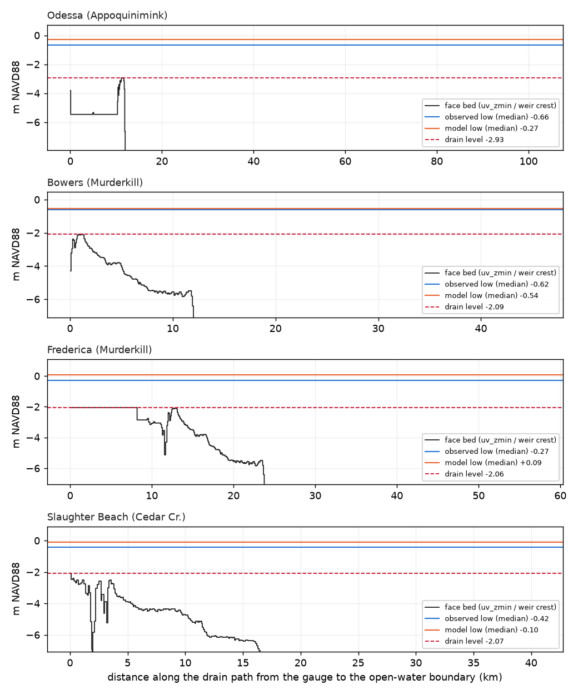

# Do the Delaware creeks drain to the observed low tide? `de_v2ap45o_100m`

Written by `scripts/check_de_creek_drain.py --model de_v2ap45o_100m --bed-tag de_v2ap45 --spinup 24`. Drain level = the lowest level the gauge's cell can drain to through the model's faces (minimax of subgrid `uv_zmin` / weir crest over paths to the open boundary). Lows: every observed low of the storm runs on disk (`<storm>_intact_slr000_<wind>`) matched with the model's, medians. m NAVD88.

Reading: model low near the drain level and both above the observed low = a sill holds the creek up; drain level well below the observed low = no sill, the creek drains too slowly.

| index | gauge | lows matched | storms | obs low (median) | model low (median) | model - obs | drain level | drain - obs low | cell z_zmin | path km | sills above obs low |
|---|---|---|---|---|---|---|---|---|---|---|---|
| 0 | Odessa (Appoquinimink) | 337 | 7 | -0.660 | -0.270 | 0.390 | -2.930 | -2.270 | -3.820 | 102.360 | 0 |
| 1 | Bowers (Murderkill) | 626 | 14 | -0.620 | -0.540 | 0.070 | -2.090 | -1.480 | -4.310 | 45.680 | 0 |
| 2 | Frederica (Murderkill) | 596 | 13 | -0.270 | 0.090 | 0.360 | -2.060 | -1.790 | -2.070 | 57.430 | 0 |
| 3 | Slaughter Beach (Cedar Cr.) | 436 | 9 | -0.420 | -0.100 | 0.330 | -2.070 | -1.650 | -2.080 | 40.710 | 0 |

## Faces on each path above the observed low

Bed codes, share of pixels within ±30 m: `bed src` (build_bed: 1 lidar, hydro-flattened; 2 CUDEM under lidar; 3 CUDEM; 4 3DEP; 5 GMRT), `bed burn_src` (build_riverbeds, 0 = not burned); `bed merged` / `bed burn` = the lowest pre-burn / burned pixel there.

(none)

