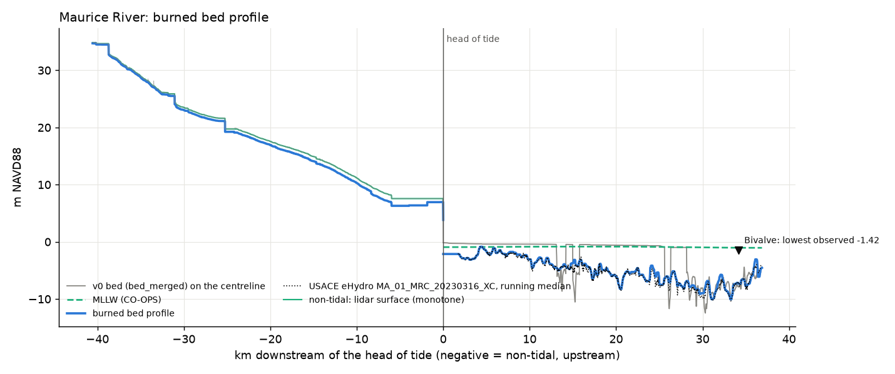
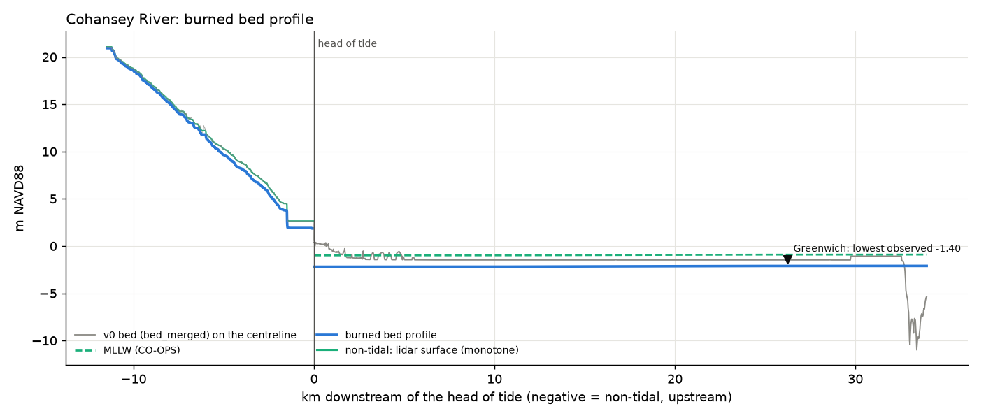
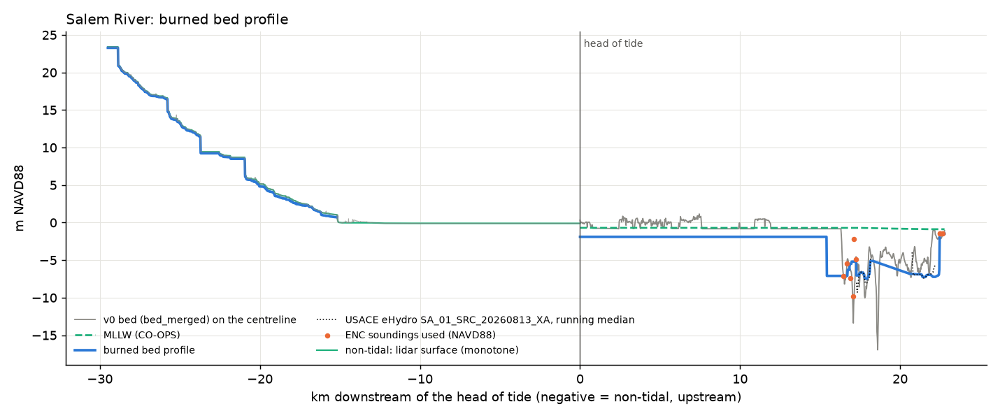
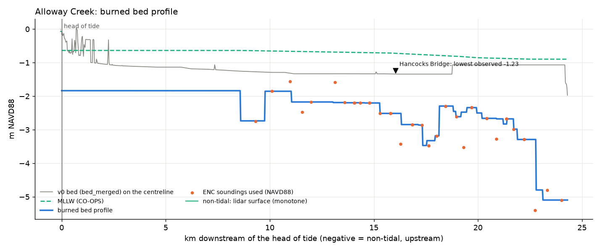

# River-bed burn (FINDINGS §11)

Generated by `scripts/check_riverbeds.py` from `scripts/build_riverbeds.py` outputs. The burn is `data/elevation/riverbed_burn.tif` (m NAVD88, the bed grid) + `riverbed_source.tif`; merge as `min(bed_merged, burn)` (it is already never-raise).

## Burned area by source

| code | source | km2 |
|---|---|---|
| 1 | tidal: ENC soundings | 4.86 |
| 2 | tidal: ENC depth area | 12.74 |
| 3 | tidal: uncharted, 1.2 m below MLLW | 7.80 |
| 4 | non-tidal: surface - gauge depth | 2.65 |
| 5 | non-tidal: surface - DA law depth | 0.59 |
| 6 | tidal: USACE eHydro survey | 9.86 |
| 7 | non-tidal: anchored to gauge stage | 0.05 |

## NOAA ENC cells with soundings in the ring

All cells are on MLLW (S-57 SDAT 12), depths in metres (DUNI 1).

| cell | scale | title | issued | soundings_in_ring |
|---|---|---|---|---|
| US5PHLBD | 12000 | Delaware River | 2026-06-17 | 647 |
| US5ILGCE | 12000 | Delaware River Including C & D Canal | 2026-10-01 | 377 |
| US5PHLBC | 12000 | Delaware River | 2026-08-31 | 369 |
| US5PHLBB | 12000 | Delaware River | 2025-02-19 | 206 |
| US5PHLAA | 12000 | Delaware River | 2025-09-26 | 190 |
| US5ILGEF | 12000 | Delaware River | 2026-06-17 | 184 |
| US5PHLBE | 12000 | Delaware River | 2026-08-03 | 157 |
| US5ILGCF | 12000 | Delaware River | 2026-06-30 | 155 |
| US5ILGDE | 12000 | Delaware River | 2026-03-24 | 123 |
| US5ILGFF | 12000 | Delaware River | 2026-09-15 | 79 |
| US5PHLAB | 12000 | Delaware River | 2024-01-18 | 18 |
| US5ILGDF | 12000 | Delaware River | 2024-04-16 | 13 |
| US5PHLBA | 12000 | Delaware River | 2024-01-18 | 4 |
| US5ILGAF | 22000 | Delaware River | 2026-03-17 | 309 |
| US5DE1LC | 22000 | Delaware River | 2026-03-17 | 131 |
| US5ILGBE | 22000 | Delaware River | 2026-08-03 | 106 |
| US5DE1KE | 22000 | Delaware Bay | 2026-01-14 | 97 |
| US5ILGAG | 22000 | Delaware River | 2024-06-20 | 93 |
| US5DE1LD | 22000 | Delaware River | 2024-06-21 | 73 |
| US5DE1IG | 22000 | Delaware Bay | 2025-11-20 | 49 |
| US5ILGBF | 22000 | Delaware River | 2024-06-17 | 47 |
| US5DE1KD | 22000 | Delaware Bay | 2026-09-28 | 26 |
| US5DE1IF | 22000 | Delaware Bay | 2026-06-17 | 16 |
| US5ILGAE | 22000 | Delaware River | 2026-03-17 | 8 |
| US5DE1JE | 22000 | Delaware Bay | 2026-08-21 | 5 |
| US4NJ1BB | 90000 | Delaware Bay - Maurice River | 2026-08-21 | 594 |
| US4DE1DB | 90000 | Delaware River - Cohansey River to Pea Patch Island | 2026-08-03 | 422 |
| US4NJ1BC | 90000 | North Atlantic Ocean - Townsends Inlet to Hereford Inlet and Delaware Bay | 2026-08-19 | 106 |
| US4DE1CB | 90000 | Delaware Bay - Murderkill River to Leipsic River | 2026-09-28 | 26 |
| US4NJ1CC | 90000 | Great Egg Harbor River and Maurice River | 2026-03-10 | 7 |
| US4NJ1CB | 90000 | Delaware Bay - Maurice River and Cohansey River | 2026-03-10 | 6 |

## Tidal reaches

| reach | river | length_km | ehydro_survey | km_ehydro | n_soundings | soundings_to_km | km_soundings | km_chart_area | km_uncharted | mllw_navd88_m | bed_p50_m | bed_min_m | bed_max_m | channel_area_km2 |
|---|---|---|---|---|---|---|---|---|---|---|---|---|---|---|
| maurice | Maurice River | 36.87 | MA_01_MRC_20230316_XC | 35.20 | 44.00 | 13.59 | 0.00 | 1.07 | 0.62 | -0.93 head .. -1.05 mouth | -4.75 | -10.04 | -0.85 | 9.73 |
| cohansey | Cohansey River | 33.95 | nan | 0.00 | 2.00 | 33.27 | 0.00 | 30.73 | 3.25 | -0.99 head .. -0.90 mouth | -2.15 | -2.19 | -2.10 | 6.73 |
| salem | Salem River | 22.77 | SA_01_SRC_20260813_XA | 5.20 | 81.00 | 16.47 | 2.17 | 15.43 | 0.00 | -0.70 head .. -0.88 mouth | -1.90 | -7.48 | -1.48 | 6.39 |
| alloway | Alloway Creek | 24.30 | nan | 0.00 | 40.00 | 8.54 | 15.65 | 0.38 | 8.30 | -0.64 head .. -0.90 mouth | -2.19 | -5.10 | -1.84 | 2.89 |
| stow | Stow Creek | 22.30 | nan | 0.00 | 0.00 | nan | 0.00 | 4.78 | 17.55 | -0.73 head .. -0.80 mouth | -2.00 | -2.60 | -1.93 | 2.73 |
| oldmans | Oldmans Creek | 17.18 | nan | 0.00 | 0.00 | nan | 0.00 | 2.38 | 14.82 | -0.47 head .. -0.65 mouth | -1.79 | -1.85 | -1.67 | 1.36 |
| raccoon | Raccoon Creek | 16.93 | nan | 0.00 | 4.00 | 16.48 | 1.73 | 7.05 | 8.18 | -0.90 head .. -0.91 mouth | -2.10 | -2.10 | -1.21 | 3.50 |
| mantua | Mantua Creek | 15.62 | nan | 0.00 | 14.00 | 14.42 | 2.40 | 0.17 | 13.07 | -0.66 head .. -0.88 mouth | -1.95 | -5.97 | -1.86 | 1.98 |
| woodbury | Woodbury Creek | 5.77 | nan | 0.00 | 32.00 | 3.21 | 3.70 | 0.00 | 2.10 | -0.91 head .. -0.91 mouth | -2.11 | -3.91 | -1.81 | 0.71 |
| big_timber | Big Timber Creek | 13.70 | nan | 0.00 | 17.00 | 12.28 | 2.80 | 0.00 | 10.93 | -0.92 head .. -0.92 mouth | -2.12 | -2.12 | -1.22 | 1.74 |

`soundings_to_km` = distance below the head of tide of the most upstream sounding. CO-OPS nodes behind each reach's MLLW line: maurice 8537359 8537242 8537147 8537059 8535055 8536780; cohansey 8537353 8537374; salem 8537979 8537961; alloway 8537889 8537779 8537753 8537774 8537731; stow 8537562 8537488 8537416; oldmans 8538274 8538369; raccoon 8538449 8540433; mantua 8538438 8538552; woodbury 8538548; big_timber 8538601 (all in `data/channels/tidal_datum_nodes.csv`).

## USACE eHydro surveys (user, 2026-10-05: they replace the chart where they reach)

Every survey of the two federal channels, its coverage of the reach (km of 25 m stations with >= 3 survey points within +-150 m) and the pick: the most recent survey covering >= 90% of the best one. All are ft below MLLW (1983-2001 epoch), US survey ft, NJ State Plane (checked in each survey's metadata); MLLW -> NAVD88 with the same CO-OPS line as the chart. The newest Maurice surveys (2024-2026) cover only the entrance channel (<= 5 km), so the full 2023 condition survey to Millville is used.

| reach | id | channel | date | type | points | coverage_km | picked | points_used |
|---|---|---|---|---|---|---|---|---|
| maurice | MA_01_MRC_20210721_CS | Maurice River | 2021-07-21 | CS | 19854 | 14.65 | False | nan |
| maurice | MA_01_MRC_20211117_CS | Maurice River | 2021-11-17 | CS | 19854 | 14.65 | False | nan |
| maurice | MA_01_MRC_20221108_XC | Maurice River | 2022-11-08 | XC | 19848 | 14.65 | False | nan |
| maurice | MA_01_MRC_20230316_XC | Maurice River | 2023-03-16 | XC | 16709 | 35.20 | True | 16,709.00 |
| maurice | MA_01_MRC_20231220_XA | Maurice River | 2023-12-20 | XA | 7963 | 14.65 | False | nan |
| maurice | MA_01_MRC_20240404_XC | Maurice River | 2024-04-04 | XC | 0 | 0.00 | False | nan |
| maurice | MA_01_MRC_20240911_XC | Maurice River | 2024-09-11 | XC | 0 | 0.00 | False | nan |
| maurice | MA_01_MRC_20250310_XC | Maurice River | 2025-03-10 | XC | 58 | 0.23 | False | nan |
| maurice | MA_01_MRC_20260302_XA | Maurice River | 2026-03-02 | XA | 17 | 0.20 | False | nan |
| salem | SA_01_SRC_20200415_CS | Salem River | 2020-04-15 | CS | 3420 | 2.75 | False | nan |
| salem | SA_01_SRC_20200924_CS | Salem River | 2020-09-24 | CS | 3124 | 2.77 | False | nan |
| salem | SA_01_SRC_20210830_CS | Salem River | 2021-08-30 | CS | 3089 | 2.73 | False | nan |
| salem | SA_01_SRC_20220223_XC | Salem River | 2022-02-23 | XC | 3228 | 2.73 | False | nan |
| salem | SA_01_SRC_20220225_XA | Salem River | 2022-02-25 | XA | 3231 | 2.73 | False | nan |
| salem | SA_01_SRC_20220816_XC | Salem River | 2022-08-16 | XC | 3130 | 2.73 | False | nan |
| salem | SA_01_SRC_20230127_XC | Salem River | 2023-01-27 | XC | 3067 | 2.75 | False | nan |
| salem | SA_01_SRC_20230310_XA | Salem River | 2023-03-10 | XA | 3067 | 2.75 | False | nan |
| salem | SA_01_SRC_20240807_XA | Salem River | 2024-08-07 | XA | 3067 | 2.75 | False | nan |
| salem | SA_01_SRC_20241120_XC | Salem River | 2024-11-20 | XC | 3429 | 2.80 | False | nan |
| salem | SA_01_SRC_20250429_XC | Salem River | 2025-04-29 | XC | 3135 | 2.80 | False | nan |
| salem | SA_01_SRC_20251121_XC | Salem River | 2025-11-21 | XC | 3391 | 2.80 | False | nan |
| salem | SA_01_SRC_20260813_XA | Salem River | 2026-08-13 | XA | 3223 | 2.77 | True | 291,012.00 |

Burned profile minus the picked survey's running median (read independently: points within 100 m of the centreline, +-150 m, >= 3 points), by burn source. The surveys cover the federal channel (Maurice 150 ft, Salem dredged channel), so where they are the source the whole NHD river polygon is painted with the channel's bed (conveyance on the high side).

| reach | survey | src | stations | burn_minus_survey_p50_m | p10_m | p90_m | km |
|---|---|---|---|---|---|---|---|
| maurice | MA_01_MRC_20230316_XC | 6 | 1403 | 0.11 | -0.09 | 0.73 | 35.08 |
| salem | SA_01_SRC_20260813_XA | 6 | 96 | 0.01 | -0.48 | 0.47 | 2.40 |

## Gauge anchors (non-tidal; user, 2026-10-05: Pitman and Swedesboro only)

Bed = gauge datum (NAVD88, checked) + median gage height at the discharge measurements in the p25-p75 flow band since 2007 - mean depth; the correction tapers to 0 over +-1.5 km (src 7).

| site | name | datum_navd88_m | stage_p50_m | n_stage | depth_m | bed_navd88_m |
|---|---|---|---|---|---|---|
| 01475001 | Mantua Creek at Pitman | 16.96 | 0.21 | 146 | 0.20 | 16.97 |
| 01477120 | Raccoon Creek near Swedesboro | -0.41 | 2.73 | 132 | 0.30 | 2.02 |

## Tidal gauge check (bed must sit below the lowest observed water)

| site | name | reach | obs_min_m | obs_p5_m | coops_mllw_m | coops_node | v0_bed_m | burn_m | merged_bed_m | below_obs_min |
|---|---|---|---|---|---|---|---|---|---|---|
| 01412150 | Maurice River at Bivalve NJ | maurice | -1.42 | -0.80 | -1.04 | 8535055 (0.0 km) | -7.64 | -7.35 | -7.64 | True |
| 01413038 | Cohansey River at Greenwich NJ | cohansey | -1.40 | -0.77 | -0.90 | 8537374 (0.0 km) | -1.48 | -2.10 | -2.10 | True |
| 01483050 | Alloway Creek at Hancocks Bridge NJ | alloway | -1.23 | -0.71 | -0.71 | 8537779 (1.3 km) | -1.34 | -2.51 | -2.51 | True |

## Stream gauge check

Water surface = gauge datum (NAVD88) + gage height. `gauge_bed_p50` = surface at each discharge measurement since 2007 minus its mean depth (area / width); `wse_meas_p50` = median surface at those measurements. `profile_*` = the non-tidal profile station nearest the gauge (<= 100 m). `burn_m` / `merged_bed_m` = lowest pixel within 30 m. `below_obs_min`: the lower of the profile bed and the merged pixel is below the lowest surface seen in the two event windows.

| site | name | da_km2 | datum_navd88_m | obs_wse_min_m | gauge_bed_p50_m | n_paired | mean_depth_m | wse_meas_p50_m | profile_surface_m | profile_bed_m | v0_bed_m | burn_m | merged_bed_m | below_obs_min | surface_minus_wse_p50_m | profile_minus_gauge_bed_m |
|---|---|---|---|---|---|---|---|---|---|---|---|---|---|---|---|---|
| 01411456 | Little Ease Run near Clayton NJ | 25.30 | nan | nan | nan | 96 | 0.25 | nan | 31.47 | 31.22 | 31.39 | 31.18 | 31.18 | None | nan | nan |
| 01411500 | Maurice River at Norma NJ | 290.08 | 13.87 | 14.59 | 14.34 | 236 | 0.42 | 14.72 | 14.86 | 14.43 | 14.66 | nan | 14.66 | True | 0.14 | 0.10 |
| 01412000 | Menantico Creek near Millville NJ | 60.09 | 9.59 | 11.09 | 10.93 | 103 | 0.29 | 11.21 | 11.36 | 11.07 | 11.29 | 11.00 | 11.00 | True | 0.15 | 0.14 |
| 01412080 | Manumuskin River at Cumberland NJ | 70.97 | 7.04 | 8.21 | 7.31 | 153 | 1.06 | 8.32 | 7.33 | 6.27 | 7.17 | 6.23 | 6.23 | True | -0.99 | -1.04 |
| 01412800 | Cohansey River at Seeley NJ | 72.52 | 7.91 | 8.77 | 8.12 | 306 | 0.66 | 8.89 | 8.88 | 8.22 | 8.80 | 8.21 | 8.21 | True | -0.01 | 0.10 |
| 01475001 | Mantua Creek at East Holly Avenue at Pitman NJ | 16.16 | 16.97 | 17.01 | 16.98 | 304 | 0.20 | 17.18 | 17.59 | 16.97 | 17.31 | 16.96 | 16.96 | True | 0.41 | -0.01 |
| 01477070 | Raccoon Creek at Wrights Mill NJ | 10.96 | 24.39 | 24.85 | 24.58 | 92 | 0.30 | 24.88 | 24.76 | 24.46 | 24.79 | 24.41 | 24.41 | True | -0.12 | -0.12 |
| 01477120 | Raccoon Creek near Swedesboro NJ | 69.67 | -0.41 | 2.16 | 1.92 | 230 | 0.30 | 2.31 | 2.71 | 2.02 | 2.71 | 2.02 | 2.02 | True | 0.40 | 0.10 |
| 01482500 | Salem River at Woodstown NJ | 37.81 | 8.63 | 12.00 | 11.84 | 245 | 0.19 | 12.03 | 6.29 | 6.09 | 6.17 | 6.08 | 6.08 | True | -5.74 | -5.75 |

## Gauge hydraulic geometry (USGS channel measurements, p25-p75 measured-flow band)

| site | name | da_km2 | n | n_band | q_lo_cms | q_hi_cms | depth_m | depth_p10_m | depth_p90_m | width_m | first | last | on_path |
|---|---|---|---|---|---|---|---|---|---|---|---|---|---|
| 01467357 | Gravelly Run at Somerdale NJ | 0.91 | 14 | 6 | 0.07 | 0.92 | 0.22 | 0.15 | 0.27 | 3.52 | 1996 | 2010 | False |
| 01475031 | Chestnut Branch at Glassboro NJ | 0.93 | 23 | 11 | 0.01 | 0.01 | 0.05 | 0.03 | 0.07 | 1.07 | 1995 | 2006 | False |
| 01475017 | Bees Branch at Hurffville NJ | 1.11 | 23 | 11 | 0.01 | 0.24 | 0.22 | 0.08 | 0.51 | 2.44 | 1996 | 2010 | False |
| 01412438 | Cohansey River trib 2 near Seeley NJ | 1.17 | 8 | 5 | 0.00 | 0.01 | 0.07 | 0.04 | 0.07 | 1.10 | 2004 | 2005 | False |
| 01475032 | Chestnut Branch at Footbridge at Glassboro NJ | 1.22 | 22 | 11 | 0.01 | 0.02 | 0.06 | 0.05 | 0.08 | 1.10 | 1995 | 2006 | False |
| 01477123 | Raccoon Creek tributary 3 near Mullica Hill NJ | 1.22 | 18 | 8 | 0.04 | 0.14 | 0.09 | 0.08 | 0.11 | 2.10 | 1996 | 2009 | False |
| 0147503450 | Cabin Run at Pitman NJ | 1.32 | 14 | 6 | 0.01 | 0.02 | 0.17 | 0.14 | 0.23 | 0.46 | 1995 | 2006 | False |
| 01412398 | Clark Branch at Beals Mill NJ | 1.45 | 13 | 7 | 0.02 | 0.22 | 0.27 | 0.22 | 0.30 | 1.74 | 2005 | 2010 | False |
| 01475033 | Plank Run at Glassboro NJ | 1.84 | 28 | 14 | 0.02 | 0.22 | 0.16 | 0.09 | 0.33 | 2.03 | 1996 | 2010 | False |
| 01477102 | Miery Run near Ewan NJ | 1.89 | 26 | 12 | 0.06 | 0.54 | 0.22 | 0.14 | 0.29 | 1.94 | 1996 | 2010 | False |
| 0147503330 | Plank Run at Pitman NJ | 2.49 | 23 | 11 | 0.03 | 0.05 | 0.06 | 0.06 | 0.11 | 1.65 | 1995 | 2006 | False |
| 01476610 | London B near Repaupo NJ | 2.77 | 14 | 6 | 0.00 | 0.02 | 0.08 | 0.05 | 0.19 | 1.71 | 1957 | 2014 | False |
| 01474950 | Mantua C at Glassboro NJ | 3.11 | 9 | 5 | 0.01 | 0.04 | 0.11 | 0.10 | 0.13 | 1.83 | 1965 | 1977 | False |
| 01482503 | Chestnut Run at Woodstown NJ | 4.87 | 14 | 7 | 0.01 | 0.02 | 0.10 | 0.07 | 0.11 | 1.55 | 2007 | 2009 | False |
| 01475250 | Nehonsey Bk near Paulsboro NJ | 4.90 | 15 | 7 | 0.00 | 0.02 | 0.14 | 0.08 | 0.28 | 2.59 | 1957 | 2014 | False |
| 01482880 | Alloway Creek near Yorktown NJ | 6.27 | 32 | 16 | 0.06 | 0.09 | 0.13 | 0.11 | 0.16 | 3.06 | 2002 | 2011 | True |
| 01413060 | Canton Drain near Canton NJ | 6.47 | 18 | 8 | 0.05 | 0.11 | 0.31 | 0.16 | 0.50 | 3.87 | 1959 | 2017 | True |
| 01476625 | Rattling Run at Tomlin NJ | 6.50 | 12 | 6 | 0.04 | 0.06 | 0.12 | 0.11 | 0.16 | 2.41 | 2009 | 2014 | True |
| 01412500 | West Branch Cohansey River at Seeley NJ | 6.68 | 77 | 39 | 0.03 | 0.05 | 0.13 | 0.07 | 0.28 | 2.56 | 1961 | 2009 | True |
| 01474970 | Mantua C at Greentree Rd at Glassboro NJ | 6.71 | 11 | 6 | 0.07 | 0.11 | 0.20 | 0.12 | 0.27 | 2.33 | 1965 | 1977 | True |
| 01475090 | Edwards Run at Jefferson NJ | 7.56 | 24 | 12 | 0.03 | 0.09 | 0.12 | 0.07 | 0.13 | 2.79 | 2005 | 2011 | True |
| 01482890 | Alloway Creek near Watson Corner NJ | 7.77 | 15 | 7 | 0.07 | 0.10 | 0.16 | 0.12 | 0.18 | 3.72 | 2002 | 2007 | True |
| 01482530 | Major Run at Sharptown NJ | 7.87 | 56 | 28 | 0.02 | 0.06 | 0.14 | 0.09 | 0.18 | 2.68 | 1966 | 2009 | True |
| 01413080 | Raccoon Ditch at Davis Mill NJ | 8.26 | 18 | 8 | 0.07 | 0.11 | 0.18 | 0.06 | 0.26 | 4.80 | 1976 | 2011 | True |
| 01411955 | Gravelly Run at Laurel Lake NJ | 8.26 | 93 | 47 | 0.03 | 0.08 | 0.23 | 0.17 | 0.30 | 2.04 | 1998 | 2023 | False |
| 01411450 | Still Rn at Aura NJ | 8.31 | 27 | 13 | 0.03 | 0.06 | 0.12 | 0.08 | 0.24 | 2.41 | 1966 | 2024 | True |
| 01477130 | Basgalore C at Russell Mill Rd near Swedesboro NJ | 8.55 | 22 | 10 | 0.05 | 0.09 | 0.10 | 0.06 | 0.13 | 2.99 | 1957 | 2003 | True |
| 01482645 | Swedes Run at Swedes Bridge near Portertown NJ | 9.19 | 16 | 8 | 0.01 | 0.07 | 0.29 | 0.13 | 0.40 | 3.34 | 2005 | 2011 | True |
| 01482950 | Cedar Bk near Alloway NJ | 9.74 | 24 | 12 | 0.05 | 0.10 | 0.12 | 0.08 | 0.72 | 3.35 | 1959 | 2012 | True |
| 01482510 | Nichomus Run near Woodstown NJ | 9.74 | 27 | 14 | 0.01 | 0.05 | 0.08 | 0.05 | 0.10 | 1.91 | 1966 | 2001 | True |
| 01411460 | Scotland Rn near Williamstown NJ | 10.26 | 25 | 13 | 0.06 | 0.11 | 0.32 | 0.18 | 0.39 | 7.62 | 1966 | 1992 | True |
| 01476600 | Still Rn near Mickleton NJ | 10.31 | 65 | 34 | 0.08 | 0.20 | 0.56 | 0.39 | 0.67 | 3.25 | 1960 | 1966 | True |
| 01477070 | Raccoon Creek at Wrights Mill NJ | 10.96 | 44 | 22 | 0.11 | 0.23 | 0.30 | 0.29 | 0.31 | 5.18 | 2011 | 2026 | True |
| 01467327 | SB Big Timber Creek trib at Grenloch NJ | 11.06 | 15 | 7 | 0.15 | 0.52 | 0.27 | 0.23 | 0.29 | 3.99 | 2003 | 2007 | True |
| 01476640 | Pargey Creek at Swedesboro Ave at Repaupo NJ | 11.50 | 20 | 10 | 0.04 | 0.11 | 0.20 | 0.14 | 0.39 | 7.27 | 2000 | 2008 | True |
| 01413020 | Indian Fields Branch at Bridgeton NJ | 12.02 | 27 | 13 | 0.13 | 0.20 | 0.19 | 0.15 | 0.26 | 3.96 | 1976 | 2017 | True |
| 01482900 | Cool Rn near Alloway NJ | 12.74 | 27 | 13 | 0.09 | 0.14 | 0.19 | 0.14 | 0.25 | 3.35 | 1959 | 2026 | True |
| 01411650 | Muddy Run near Elmer NJ | 12.79 | 19 | 9 | 0.02 | 0.08 | 0.14 | 0.12 | 0.26 | 3.96 | 1994 | 2003 | True |
| 01483010 | Deep Run near Alloway NJ | 13.73 | 44 | 22 | 0.09 | 0.23 | 0.23 | 0.15 | 0.31 | 4.77 | 1977 | 2011 | True |
| 01411680 | Palatine Branch at Palatine NJ | 13.96 | 23 | 11 | 0.06 | 0.18 | 0.15 | 0.11 | 0.21 | 2.71 | 1994 | 2004 | True |
| 01412710 | Foster Rn at Seeley NJ | 14.89 | 27 | 13 | 0.20 | 0.29 | 0.37 | 0.23 | 0.54 | 3.29 | 1951 | 2009 | True |
| 01475000 | Mantua Creek at Pitman NJ | 15.67 | 143 | 71 | 0.23 | 0.43 | 0.21 | 0.15 | 0.28 | 3.96 | 1960 | 2009 | True |
| 01475001 | Mantua Creek at East Holly Avenue at Pitman NJ | 16.16 | 160 | 80 | 0.21 | 0.41 | 0.20 | 0.16 | 0.26 | 6.40 | 2009 | 2026 | True |
| 01475100 | Edwards Run near Mantua NJ | 16.71 | 9 | 5 | 0.06 | 0.08 | 0.11 | 0.08 | 0.12 | 3.05 | 1957 | 2006 | True |
| 01411466 | Indian B near Malaga NJ | 16.83 | 73 | 38 | 0.12 | 0.32 | 0.68 | 0.50 | 0.81 | 4.27 | 1957 | 2017 | True |
| 01467350 | North Branch Big Timber Creek at Laurel Springs NJ | 16.96 | 39 | 19 | 0.24 | 0.35 | 0.24 | 0.16 | 0.34 | 6.40 | 1959 | 2015 | True |
| 01411444 | West Creek near Leesburg NJ | 17.20 | 79 | 39 | 0.04 | 0.29 | 0.62 | 0.51 | 0.78 | 3.66 | 1998 | 2023 | True |
| 01413010 | Barrett Run near Bridgeton NJ | 18.18 | 16 | 8 | 0.06 | 0.09 | 0.16 | 0.11 | 0.26 | 2.77 | 1966 | 2008 | True |
| 01411695 | Indian Run at Husted Station Road at Palatine NJ | 19.40 | 24 | 12 | 0.05 | 0.16 | 0.17 | 0.12 | 0.26 | 4.39 | 2005 | 2011 | True |
| 01413050 | Stow C at Jericho NJ | 20.90 | 18 | 8 | 0.19 | 0.34 | 0.18 | 0.12 | 0.28 | 5.27 | 1966 | 2024 | True |
| 01477118 | SB Raccoon C near Mullica Hill NJ | 21.50 | 15 | 7 | 0.05 | 0.24 | 0.15 | 0.08 | 0.17 | 4.11 | 1966 | 2007 | True |
| 0141145260 | Reed Branch near Franklinville NJ | 21.86 | 11 | 5 | 0.17 | 0.54 | 0.38 | 0.18 | 0.49 | 7.32 | 2011 | 2022 | True |
| 01411461 | Scotland Run at Fries Mill NJ | 23.96 | 29 | 15 | 0.17 | 0.35 | 0.44 | 0.26 | 0.51 | 5.79 | 1990 | 2012 | True |
| 01412405 | Cohansey R near Beals Mill NJ | 24.45 | 22 | 10 | 0.10 | 0.17 | 0.14 | 0.13 | 0.22 | 3.05 | 1976 | 2024 | True |
| 01411456 | Little Ease Run near Clayton NJ | 25.30 | 285 | 144 | 0.09 | 0.49 | 0.25 | 0.16 | 0.37 | 5.24 | 1966 | 2016 | True |
| 01477100 | Raccoon C near Mullica Hill NJ | 26.16 | 17 | 9 | 0.18 | 0.47 | 0.35 | 0.20 | 0.54 | 5.79 | 1959 | 2007 | True |
| 01411495 | Blackwater Branch at Norma NJ | 32.37 | 58 | 28 | 0.29 | 0.68 | 0.39 | 0.28 | 0.64 | 6.26 | 1992 | 2009 | True |
| 01411950 | Buckshutem C near Laurel Lake NJ | 33.41 | 18 | 8 | 0.01 | 0.12 | 0.16 | 0.13 | 0.28 | 1.51 | 1976 | 2008 | True |
| 01412120 | Muskee C near Port Elizabeth NJ | 33.93 | 19 | 9 | 0.26 | 0.56 | 0.17 | 0.13 | 0.49 | 6.31 | 1969 | 2008 | True |
| 01477480 | Oldmans Creek near Harrisonville NJ | 35.74 | 30 | 14 | 0.35 | 1.15 | 0.72 | 0.45 | 1.23 | 7.70 | 1974 | 2014 | True |
| 01475019 | Mantua Creek at Salina NJ | 36.52 | 13 | 7 | 1.78 | 6.71 | 0.71 | 0.44 | 0.98 | 8.53 | 1974 | 1986 | True |
| 01475020 | Mantua Creek at Sewell NJ | 37.55 | 27 | 13 | 0.27 | 0.47 | 0.24 | 0.21 | 0.30 | 5.73 | 1966 | 2001 | True |
| 01482500 | Salem River at Woodstown NJ | 37.81 | 414 | 207 | 0.19 | 0.56 | 0.19 | 0.14 | 0.27 | 5.64 | 1940 | 2026 | True |
| 01411462 | Scotland Rn at Franklinville NJ | 38.33 | 22 | 10 | 0.20 | 0.45 | 0.26 | 0.17 | 0.38 | 8.31 | 1976 | 1990 | True |
| 01411850 | Mill C near Millville NJ | 39.11 | 21 | 11 | 0.18 | 0.32 | 0.26 | 0.23 | 0.31 | 4.42 | 1973 | 1997 | True |
| 01477110 | Raccoon Creek at Mullica Hill NJ | 40.40 | 29 | 15 | 0.32 | 2.46 | 0.30 | 0.19 | 0.54 | 7.92 | 1940 | 2007 | True |
| 01482505 | Salem River at US Route 40 at Woodstown NJ | 43.51 | 14 | 6 | 0.13 | 0.49 | 0.38 | 0.34 | 0.56 | 10.29 | 2007 | 2009 | True |
| 01467359 | North Branch Big Timber Creek at Glendora NJ | 48.69 | 73 | 37 | 0.66 | 1.51 | 0.29 | 0.22 | 0.42 | 10.06 | 1997 | 2023 | True |
| 01467329 | SB Big Timber C at Blackwood Terrace NJ | 49.47 | 21 | 12 | 0.51 | 0.93 | 0.38 | 0.31 | 0.58 | 5.94 | 1979 | 1997 | True |
| 01467330 | South Branch Big Timber Creek at Blackwood NJ | 50.76 | 44 | 22 | 0.50 | 1.14 | 0.34 | 0.24 | 0.61 | 8.08 | 1963 | 2016 | True |
| 01483000 | Alloway Creek at Alloway NJ | 52.58 | 68 | 34 | 0.28 | 0.84 | 0.35 | 0.19 | 0.58 | 8.23 | 1960 | 1972 | True |
| 01477510 | Oldmans Creek at Porches Mill NJ | 54.39 | 26 | 12 | 0.33 | 1.31 | 0.86 | 0.79 | 1.07 | 13.03 | 1979 | 2012 | True |
| 01482508 | Salem River at US Route 40 at Sharptown NJ | 57.50 | 13 | 7 | 0.16 | 0.54 | 0.11 | 0.10 | 0.20 | 9.66 | 2007 | 2009 | True |
| 01412000 | Menantico Creek near Millville NJ | 60.09 | 124 | 62 | 0.55 | 1.43 | 0.29 | 0.20 | 0.74 | 8.95 | 1977 | 2024 | True |
| 01412005 | Menantico Creek at Route 49 at Millville NJ | 68.12 | 32 | 16 | 0.83 | 1.43 | 0.42 | 0.38 | 0.51 | 8.41 | 2002 | 2011 | True |
| 01411453 | Still Rn near Malaga NJ | 69.67 | 14 | 6 | 1.07 | 2.36 | 0.60 | 0.47 | 0.95 | 15.53 | 2002 | 2017 | False |
| 01477120 | Raccoon Creek near Swedesboro NJ | 69.67 | 546 | 272 | 0.54 | 1.29 | 0.30 | 0.22 | 0.49 | 10.06 | 1965 | 2026 | True |
| 01482519 | Salem River at Main Street at Sharptown NJ | 70.19 | 14 | 6 | 0.17 | 0.58 | 0.42 | 0.35 | 2.13 | 12.50 | 2007 | 2009 | True |
| 01482520 | Salem River at Sharptown NJ | 70.71 | 16 | 8 | 0.20 | 0.70 | 0.33 | 0.22 | 0.44 | 9.14 | 1966 | 1974 | True |
| 01412080 | Manumuskin River at Cumberland NJ | 70.97 | 80 | 40 | 0.47 | 1.11 | 1.06 | 0.79 | 1.58 | 10.99 | 1967 | 2026 | True |
| 01412800 | Cohansey River at Seeley NJ | 72.52 | 324 | 163 | 0.66 | 1.26 | 0.66 | 0.31 | 0.82 | 11.19 | 1977 | 2026 | True |
| 01412100 | Manumuskin R near Manumuskin NJ | 83.14 | 21 | 11 | 0.33 | 0.95 | 1.01 | 0.36 | 1.40 | 6.86 | 1964 | 2008 | True |
| 01482537 | Salem River at Courses Landing NJ | 92.98 | 11 | 5 | 0.47 | 0.81 | 1.56 | 1.46 | 1.64 | 27.46 | 2007 | 2009 | True |
| 01411700 | Muddy Rn at Centerton NJ | 94.53 | 22 | 10 | 0.41 | 0.85 | 0.26 | 0.20 | 1.28 | 9.68 | 1976 | 2026 | True |
| 01411740 | Muddy Run at Parvin Mill Road near Norma NJ | 123.80 | 13 | 7 | 0.67 | 1.88 | 0.18 | 0.12 | 0.37 | 15.70 | 2011 | 2017 | True |
| 01482580 | Salem Canal at US Route 130 at Deepwater NJ | 151.00 | 16 | 8 | 0.47 | 0.64 | 2.03 | 1.78 | 2.09 | 21.52 | 2007 | 2009 | True |
| 01411485 | Maurice River at Brotmanville NJ | 228.18 | 21 | 11 | 1.38 | 4.28 | 0.66 | 0.44 | 0.74 | 11.89 | 1992 | 2015 | True |
| 01411500 | Maurice River at Norma NJ | 290.08 | 375 | 188 | 2.44 | 5.95 | 0.42 | 0.27 | 0.78 | 28.12 | 1940 | 2026 | True |
| 01411800 | Maurice R near Millville NJ | 494.69 | 22 | 10 | 2.88 | 8.20 | 1.27 | 0.66 | 1.41 | 16.46 | 1966 | 2002 | True |
| 01411878 | Maurice R at Union Lake dam at Millville NJ | 559.44 | 29 | 15 | 3.96 | 6.80 | 0.60 | 0.43 | 1.36 | 25.91 | 1973 | 1994 | True |
| 01411880 | Maurice River at Sharp St at Millville NJ | 559.44 | 25 | 13 | 3.68 | 6.57 | 0.65 | 0.42 | 1.38 | 26.52 | 1973 | 2008 | True |

## Non-tidal level paths

168 paths, 409 km, of which 55 km in lakes (not painted); 34 anchored to a gauge on the path.

| reach | river | length_km | da_km2_min | da_km2_max | gauges | depth_m | width_m | km_in_lakes | km_low_surface_unburned | anchored | surface_drop_m | bed_p50_m |
|---|---|---|---|---|---|---|---|---|---|---|---|---|
| lp10000200004898 | Maurice River | 40.56 | 10.10 | 558.49 | 01411450 01411485 01411800 01411878 01411880 | 0.13..1.27 | 2.6..25.8 | 8.37 | 0.00 | nan | 30.42 | 17.09 |
| lp10000200007955 | nan | 0.47 | 495.03 | 497.14 | nan | 0.76..0.76 | 23.5..23.6 | 0.48 | 0.00 | nan | 0.00 | 6.80 |
| lp10000200008021 | nan | 0.58 | 494.75 | 495.22 | nan | 0.76..0.76 | 23.5..23.5 | 0.56 | 0.00 | nan | 0.00 | 6.80 |
| lp10000200008193 | nan | 0.30 | 494.62 | 494.77 | nan | 0.76..0.76 | 23.5..23.5 | 0.09 | 0.00 | nan | 0.27 | 7.08 |
| lp10000200008368 | nan | 0.08 | 493.64 | 493.64 | nan | 0.76..0.76 | 23.5..23.5 | 0.00 | 0.00 | nan | 0.00 | 6.80 |
| lp10000200008392 | nan | 0.09 | 492.47 | 492.47 | nan | 0.76..0.76 | 23.5..23.5 | 0.00 | 0.00 | nan | 0.00 | 6.80 |
| lp10000200008512 | nan | 0.57 | 467.61 | 467.88 | nan | 0.74..0.74 | 22.9..22.9 | 0.00 | 0.00 | nan | 0.72 | 7.30 |
| lp10000200008549 | nan | 0.07 | 467.86 | 467.86 | nan | 0.74..0.74 | 22.9..22.9 | 0.00 | 0.00 | nan | 0.00 | 6.82 |
| lp10000200009168 | nan | 0.08 | 316.99 | 316.99 | nan | 0.65..0.65 | 19.0..19.0 | 0.00 | 0.00 | nan | 0.00 | 9.29 |
| lp10000200009419 | nan | 0.13 | 316.85 | 316.85 | nan | 0.65..0.65 | 19.0..19.0 | 0.00 | 0.00 | nan | 0.12 | 9.41 |
| lp10000200009771 | nan | 0.06 | 314.94 | 314.95 | nan | 0.65..0.65 | 18.9..18.9 | 0.00 | 0.00 | nan | 0.00 | 10.15 |
| lp10000200009952 | nan | 0.07 | 314.75 | 314.75 | nan | 0.65..0.65 | 18.9..18.9 | 0.00 | 0.00 | nan | 0.00 | 10.50 |
| lp10000200010133 | nan | 0.04 | 314.42 | 314.42 | nan | 0.65..0.65 | 18.9..18.9 | 0.00 | 0.00 | nan | 0.00 | 10.59 |
| lp10000200010332 | nan | 0.08 | 314.35 | 314.35 | nan | 0.65..0.65 | 18.9..18.9 | 0.00 | 0.00 | nan | 0.00 | 10.93 |
| lp10000200010832 | nan | 0.14 | 301.44 | 301.44 | nan | 0.64..0.64 | 18.5..18.5 | 0.00 | 0.00 | nan | 0.03 | 11.44 |
| lp10000200011546 | nan | 1.17 | 291.98 | 292.37 | nan | 0.63..0.63 | 18.2..18.2 | 0.00 | 0.00 | nan | 0.94 | 13.16 |
| lp10000200011425 | nan | 0.07 | 292.05 | 292.05 | nan | 0.63..0.63 | 18.2..18.2 | 0.00 | 0.00 | nan | 0.00 | 13.19 |
| lp10000200011475 | nan | 0.10 | 292.05 | 292.05 | nan | 0.63..0.63 | 18.2..18.2 | 0.00 | 0.00 | nan | 0.00 | 13.24 |
| lp10000200012408 | nan | 0.17 | 289.56 | 289.56 | 01411500 | 0.42..0.42 | 28.1..28.1 | 0.00 | 0.00 | nan | 0.05 | 14.43 |
| lp10000200012854 | nan | 0.14 | 289.51 | 289.52 | nan | 0.63..0.63 | 18.2..18.2 | 0.00 | 0.00 | nan | 0.01 | 14.29 |
| lp10000200013252 | nan | 0.06 | 287.07 | 287.07 | nan | 0.63..0.63 | 18.1..18.1 | 0.00 | 0.00 | nan | 0.00 | 14.81 |
| lp10000200014322 | nan | 0.06 | 202.04 | 202.05 | nan | 0.56..0.56 | 15.3..15.3 | 0.00 | 0.00 | nan | 0.00 | 19.02 |
| lp10000200014906 | nan | 0.07 | 201.98 | 201.98 | nan | 0.56..0.56 | 15.3..15.3 | 0.00 | 0.00 | nan | 0.00 | 19.07 |
| lp10000200016173 | Salem Canal | 2.98 | 149.65 | 151.53 | 01482580 | 2.03..2.04 | 21.4..21.6 | 0.00 | 2.99 | nan | 0.00 | nan |
| lp10000200006637 | Salem River | 29.50 | 10.64 | 149.72 | 01482500 01482505 01482508 01482519 01482520 01482537 | 0.11..1.83 | 3.1..34.6 | 4.76 | 15.17 | nan | 23.51 | 8.88 |
| lp10000200009593 | Muddy Run | 23.33 | 23.22 | 149.62 | 01411700 01411740 | 0.16..0.26 | 4.9..17.2 | 6.72 | 0.00 | nan | 21.78 | 20.75 |
| lp10000200009725 | nan | 0.21 | 149.19 | 149.19 | nan | 0.50..0.50 | 13.2..13.2 | 0.00 | 0.00 | nan | 0.21 | 9.91 |
| lp10000200009770 | nan | 0.66 | 146.27 | 146.64 | nan | 0.50..0.50 | 13.1..13.1 | 0.00 | 0.00 | nan | 0.84 | 10.62 |
| lp10000200009855 | nan | 0.16 | 146.43 | 146.47 | nan | 0.50..0.50 | 13.1..13.1 | 0.00 | 0.00 | nan | 0.10 | 10.64 |
| lp10000200009966 | nan | 0.06 | 146.24 | 146.24 | nan | 0.50..0.50 | 13.1..13.1 | 0.00 | 0.00 | nan | 0.00 | 10.73 |

(30 largest by drainage area; all rows in `data/elevation/river_table.csv`.)

## Caveats

- ENC soundings stop near every creek mouth: inside the Cohansey there are none, the Maurice has them only below ~13.6 km from Millville (now replaced by the 2023 survey), and Stow / Oldmans have none at all. Most other tidal length is the chart's "0-1.8 m" depth area or uncharted: 1.2 m below MLLW for both (user, 2026-10-05).
- MLLW in NAVD88 comes from CO-OPS: datum sheets with a NAVD88 tie, and subordinate tide-prediction stations whose MTL is borrowed from the nearest tied station (no geodetic tie exists for them; +-~0.1 m). VDatum's API returns 412 / -999999 on these creeks.
- Non-tidal beds sit on the lidar flight-day water surface; at gauges with a NAVD88 datum that surface is -0.1 to +0.15 m from the median measured stage, except Pitman and Swedesboro (+0.4 m), which are now anchored to the gauge (above).
- Salem River at Woodstown 01482500: gauge datum + gage height = ~12.0 m, but the lidar lake surface above the dam is 8.7 m and the tailwater 6.3 m: the published datum (28.32 ft NAVD88) does not match; that gauge cannot check absolute levels. Manumuskin 01412080 is the opposite: lidar 1.0 m BELOW the measured stage.
- 66 km of 'non-tidal' profile (above an NJDEP head-of-tide point) has a lidar surface below 1 m NAVD88 (most on the Salem River level path and Still Run): tidal elevations, likely diked / tide-gated meadow. It is LEFT UNBURNED (user, 2026-10-05; handled with the drainage structures).
- NHDPlus HR lakes / reservoirs >= 1 ha are not painted (Union Lake etc. keep the fake flat bed; that is a separate fix).

## Profiles

