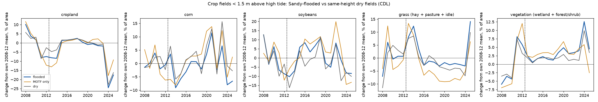

# Sandy panel: a first look (descriptive)

Written by `scripts/plot_sandy_panel.py` from `data/analysis/sandy_panel/` (docstring: groups, weights). No model fits.

Fields: LU/LC farm in 2012, < 1.5 m above MHHW, at least half cropland over 2008-12. Flooded = the model floods at least 10% of the field; MOTF only = the model leaves it dry but FEMA's dike-blind bathtub floods it; dry = dry in both. Dry and MOTF-only fields are reweighted to the flooded fields' height mix.

| group | fields | ha | median_m_above_mhhw |
|---|---|---|---|
| MOTF only | 169 | 254.22 | 0.87 |
| dry | 324 | 514.34 | 0.84 |
| flooded | 428 | 1,803.47 | 0.37 |

Change from each group's own 2008-12 mean, percentage points of field area; flooded - dry with a 95% interval from resampling fields (500 draws):

| outcome | flooded, 2013-16 | flooded, 2017-25 | MOTF only, 2013-16 | MOTF only, 2017-25 | dry, 2013-16 | dry, 2017-25 | flooded - dry, 2013-16 | flooded - dry, 2017-25 |
|---|---|---|---|---|---|---|---|---|
| cropland | -3.4 | -4.7 | -5.7 | -2.0 | -1.4 | -3.9 | -2.1 [-3.9, +0.2] | -0.8 [-4.8, +2.5] |
| corn | -3.6 | +0.4 | -4.2 | +4.7 | -0.5 | +3.4 | -3.1 [-7.3, +1.3] | -3.0 [-8.3, +1.7] |
| soybeans | -0.8 | +0.3 | +0.7 | +3.5 | -6.2 | -2.3 | +5.5 [+1.0, +10.5] | +2.6 [-3.5, +9.0] |
| grass (hay + pasture + idle) | +5.3 | -0.4 | +3.8 | -5.9 | +3.4 | -1.8 | +1.8 [-2.4, +5.5] | +1.4 [-2.4, +5.0] |
| vegetation (wetland + forest/shrub) | +1.8 | +4.3 | +2.7 | +3.5 | +1.5 | +2.8 | +0.3 [-1.3, +1.7] | +1.5 [-1.0, +4.0] |

CDL 2012 is the summer BEFORE Sandy (Oct 29): a gap already open in 2012 is not Sandy's doing.

Caveats: CDL class definitions jump between years (pasture 2% of field area in 2012 vs 15% in 2013; idle ~0 from 2016; cropland and developed in 2024), which moves every group; only the gap between groups is informative. Sandy flooding is modelled with today's dikes. Fields within a farm are not independent, so the intervals are too narrow if anything.
