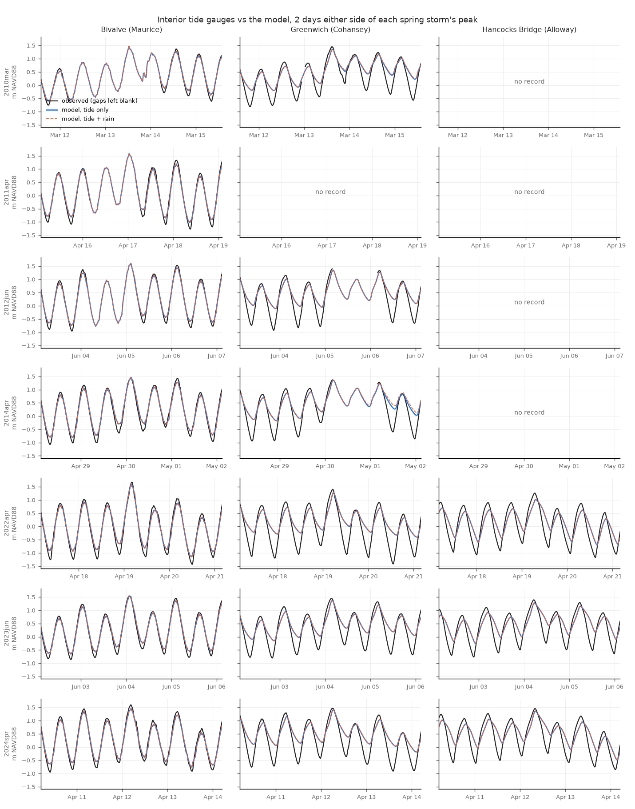

# Spring storm tides at the interior gauges

Generated by `scripts/validate_storm_gauges.py`. The §33 Sandy check repeated for the 7 spring
storms of the storm panel (FINDINGS §37): every observed high tide in each run window against
the model's highest level within ±3 h, runs `<storm>_intact_slr000` (tide only) and `_rain`.
Metres NAVD88; diff and bias = model − observed. Highs and lows count only where the record is
complete around them. "storm high" = the model's highest level within a day of the Ship John
peak vs the observed maximum within ±3 h; blank where the gauge was out at that time (it often
is). The gauges sit in the creek mouths: they test the water the creeks deliver to the banks,
not flooding on the fields.

## Per storm and gauge

| index | storm | gauge | n_highs | bias_all_m | rmse_all_m | bias_top5_m | bias_lows_m | storm_high_obs_m | storm_high_model_m | storm_high_diff_m | rain_adds_m |
|---|---|---|---|---|---|---|---|---|---|---|---|
| 0 | storm2010mar | Bivalve (Maurice) | 39 | -0.08 | +0.11 | -0.09 | +0.19 | +nan | +1.47 | +nan | +0.00 |
| 1 | storm2010mar | Greenwich (Cohansey) | 43 | -0.14 | +0.15 | -0.10 | +0.68 | +1.45 | +1.34 | -0.11 | +0.00 |
| 2 | storm2011apr | Bivalve (Maurice) | 40 | -0.06 | +0.11 | -0.09 | +0.21 | +nan | +1.58 | +nan | +0.00 |
| 3 | storm2012jun | Bivalve (Maurice) | 41 | -0.06 | +0.10 | -0.09 | +0.17 | +nan | +1.60 | +nan | -0.00 |
| 4 | storm2012jun | Greenwich (Cohansey) | 38 | -0.14 | +0.15 | -0.14 | +0.62 | +nan | +1.35 | +nan | +0.00 |
| 5 | storm2014apr | Bivalve (Maurice) | 43 | -0.06 | +0.10 | -0.08 | +0.19 | +1.45 | +1.47 | +0.02 | +0.00 |
| 6 | storm2014apr | Greenwich (Cohansey) | 24 | -0.14 | +0.14 | -0.16 | +0.70 | +nan | +1.36 | +nan | +0.00 |
| 7 | storm2022apr | Bivalve (Maurice) | 43 | -0.07 | +0.08 | -0.08 | +0.19 | +1.67 | +1.60 | -0.07 | +0.00 |
| 8 | storm2022apr | Greenwich (Cohansey) | 42 | -0.16 | +0.16 | -0.17 | +0.65 | +1.40 | +1.28 | -0.12 | +0.01 |
| 9 | storm2022apr | Hancocks Bridge (Alloway) | 42 | -0.20 | +0.21 | -0.22 | +0.40 | +1.26 | +1.02 | -0.24 | +0.01 |
| 10 | storm2023jun | Bivalve (Maurice) | 43 | -0.05 | +0.07 | -0.06 | +0.18 | +1.54 | +1.55 | +0.00 | -0.00 |
| 11 | storm2023jun | Greenwich (Cohansey) | 43 | -0.14 | +0.15 | -0.14 | +0.60 | +1.44 | +1.37 | -0.08 | -0.00 |
| 12 | storm2023jun | Hancocks Bridge (Alloway) | 42 | -0.16 | +0.17 | -0.17 | +0.49 | +1.40 | +1.28 | -0.12 | +0.00 |
| 13 | storm2024spr | Bivalve (Maurice) | 106 | -0.07 | +0.10 | -0.11 | +0.18 | +1.60 | +1.46 | -0.14 | +0.00 |
| 14 | storm2024spr | Greenwich (Cohansey) | 106 | -0.15 | +0.16 | -0.08 | +0.65 | +1.46 | +1.41 | -0.05 | +0.00 |
| 15 | storm2024spr | Hancocks Bridge (Alloway) | 106 | -0.20 | +0.21 | -0.13 | +0.45 | +1.45 | +1.36 | -0.09 | +0.00 |

## Mean over the storms

| gauge | bias_all_m | rmse_all_m | bias_top5_m | bias_lows_m | storm_high_diff_m | storms_with_peak_observed |
|---|---|---|---|---|---|---|
| Bivalve (Maurice) | -0.07 | +0.09 | -0.09 | +0.19 | -0.05 | 4 |
| Greenwich (Cohansey) | -0.14 | +0.15 | -0.13 | +0.65 | -0.09 | 4 |
| Hancocks Bridge (Alloway) | -0.19 | +0.19 | -0.17 | +0.45 | -0.15 | 3 |

