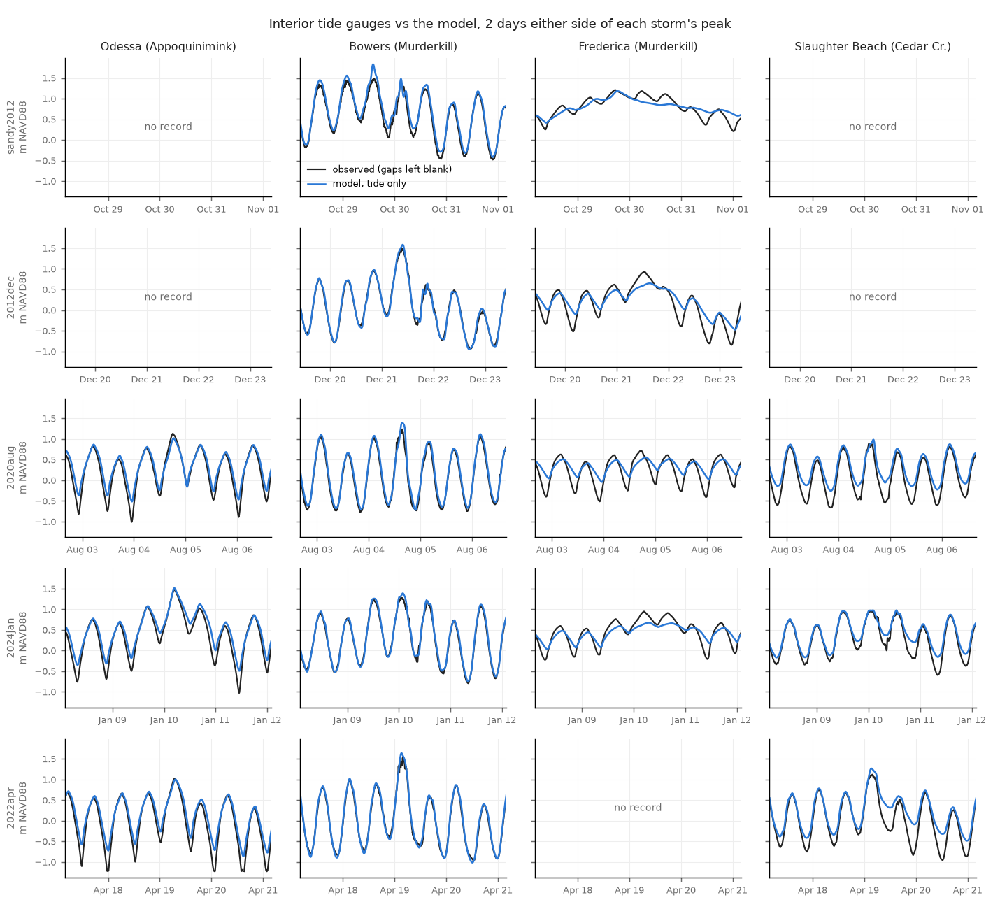

# Storm tides at the interior gauges (de_v2ap45o_100m_m70_wind)

Generated by `scripts/validate_storm_gauges.py --model de_v2ap45o_100m --wind --variant _m70 --spinup 24`. The §33 Sandy check repeated for 5 storm tides
of the storm panel (FINDINGS §37): every observed high tide in each run window against
the model's highest level within ±3 h, runs `<storm>_intact_slr000_m70<wind>` (tide only) and `_rain_m70<wind>` (where staged).
Metres NAVD88; diff and bias = model − observed. Highs and lows count only where the record is
complete around them. "storm high" = the model's highest level within a day of the Ship John
peak vs the observed maximum within ±3 h; blank where the gauge was out at that time (it often
is). "map" rows are read hourly, so their storm highs can come out a few cm low. The gauges sit in the creeks (Odessa and Frederica well up them): they test the water the creeks deliver to the banks,
not flooding on the fields.
The first 24 h of each run are left out of the tide scores: the runs start dry (zsini = -1 m) and
the first flood overshoots at the lower-bay creek mouths (Bowers 2.46 m, model, on 2023-05-21).
`<wind>` = each storm's wind run: `_era5` (x 1.3) before HRRR's start (2014-07), `_hrrr` after
(`events.wind_suffix`, FINDINGS §50).
Delaware gauges, north to south: Odessa (Appoquinimink; record from 2020-03), Bowers and
Frederica (Murderkill, from 2011-10 and 2007-10), Cedar Creek near Slaughter Beach (from
2017-06). Odessa, Bowers and Slaughter Beach are the tide calibration's gauges (FINDINGS §51,
§54); Frederica, ~7 km (straight line) up the Murderkill from Bowers, is held out. Bowers is gage height, on
NAVD88 by its USGS gauge datum (0.0 ft NAVD88). The storm peak is timed at Ship John, as on NJ.

## Per storm and gauge

| index | storm | gauge | series | n_highs | bias_all_m | rmse_all_m | bias_top5_m | bias_lows_m | storm_high_obs_m | storm_high_model_m | storm_high_diff_m | rain_adds_m |
|---|---|---|---|---|---|---|---|---|---|---|---|---|
| 0 | sandy2012 | Bowers (Murderkill) | his | 39 | +0.07 | +0.09 | +0.16 | +0.07 | +1.48 | +1.83 | +0.35 | +nan |
| 1 | sandy2012 | Frederica (Murderkill) | his | 39 | -0.07 | +0.09 | -0.12 | +0.30 | +1.21 | +1.18 | -0.03 | +nan |
| 2 | storm2012dec | Bowers (Murderkill) | his | 40 | +0.04 | +0.05 | +0.10 | -0.01 | +1.50 | +1.58 | +0.09 | +nan |
| 3 | storm2012dec | Frederica (Murderkill) | his | 40 | -0.10 | +0.12 | -0.17 | +0.27 | +0.93 | +0.65 | -0.28 | +nan |
| 4 | storm2020aug | Odessa (Appoquinimink) | his | 41 | +0.04 | +0.05 | -0.01 | +0.36 | +1.13 | +1.02 | -0.11 | +nan |
| 5 | storm2020aug | Bowers (Murderkill) | his | 41 | +0.04 | +0.05 | +0.08 | +0.06 | +1.24 | +1.40 | +0.16 | +nan |
| 6 | storm2020aug | Frederica (Murderkill) | his | 41 | -0.09 | +0.10 | -0.14 | +0.36 | +0.72 | +0.56 | -0.16 | +nan |
| 7 | storm2020aug | Slaughter Beach (Cedar Cr.) | his | 41 | +0.06 | +0.07 | +0.07 | +0.38 | +0.90 | +0.99 | +0.09 | +nan |
| 8 | storm2024jan | Odessa (Appoquinimink) | his | 52 | +0.03 | +0.05 | +0.04 | +0.38 | +1.48 | +1.52 | +0.04 | +nan |
| 9 | storm2024jan | Bowers (Murderkill) | his | 52 | +0.03 | +0.04 | +0.08 | +0.01 | +1.29 | +1.39 | +0.10 | +nan |
| 10 | storm2024jan | Frederica (Murderkill) | his | 52 | -0.11 | +0.12 | -0.21 | +0.27 | +0.95 | +0.68 | -0.27 | +nan |
| 11 | storm2024jan | Slaughter Beach (Cedar Cr.) | his | 52 | +0.02 | +0.03 | +0.05 | +0.24 | +0.97 | +0.98 | +0.01 | +nan |
| 12 | storm2022apr | Odessa (Appoquinimink) | his | 40 | +0.04 | +0.05 | +0.02 | +0.40 | +1.02 | +1.01 | -0.02 | +nan |
| 13 | storm2022apr | Bowers (Murderkill) | his | 41 | +0.01 | +0.03 | +0.03 | -0.03 | +1.53 | +1.64 | +0.11 | +nan |
| 14 | storm2022apr | Slaughter Beach (Cedar Cr.) | his | 40 | +0.01 | +0.03 | +0.04 | +0.23 | +1.12 | +1.27 | +0.15 | +nan |

## Mean over the storms

| gauge | bias_all_m | rmse_all_m | bias_top5_m | bias_lows_m | storm_high_diff_m | storms_with_peak_observed |
|---|---|---|---|---|---|---|
| Bowers (Murderkill) | +0.04 | +0.05 | +0.09 | +0.02 | +0.16 | 5 |
| Frederica (Murderkill) | -0.09 | +0.11 | -0.16 | +0.30 | -0.19 | 4 |
| Odessa (Appoquinimink) | +0.04 | +0.05 | +0.02 | +0.38 | -0.03 | 3 |
| Slaughter Beach (Cedar Cr.) | +0.03 | +0.04 | +0.05 | +0.28 | +0.08 | 3 |

