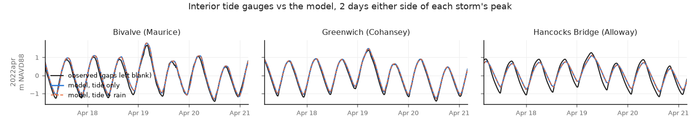

# Storm tides at the interior gauges (e3v2a30brm65_100m)

Generated by `scripts/validate_storm_gauges.py --model e3v2a30brm65_100m`. The §33 Sandy check repeated for 1 storm tides
of the storm panel (FINDINGS §37): every observed high tide in each run window against
the model's highest level within ±3 h, runs `<storm>_intact_slr000` (tide only) and `_rain` (where staged).
Metres NAVD88; diff and bias = model − observed. Highs and lows count only where the record is
complete around them. "storm high" = the model's highest level within a day of the Ship John
peak vs the observed maximum within ±3 h; blank where the gauge was out at that time (it often
is). "map" rows are read hourly, so their storm highs can come out a few cm low. The gauges sit in the creek mouths: they test the water the creeks deliver to the banks,
not flooding on the fields.

## Per storm and gauge

| index | storm | gauge | series | n_highs | bias_all_m | rmse_all_m | bias_top5_m | bias_lows_m | storm_high_obs_m | storm_high_model_m | storm_high_diff_m | rain_adds_m |
|---|---|---|---|---|---|---|---|---|---|---|---|---|
| 0 | storm2022apr | Bivalve (Maurice) | his | 43 | +0.05 | +0.07 | +0.06 | +0.07 | +1.67 | +1.80 | +0.12 | +0.00 |
| 1 | storm2022apr | Greenwich (Cohansey) | his | 42 | +0.02 | +0.03 | +0.03 | +0.11 | +1.40 | +1.49 | +0.09 | +0.00 |
| 2 | storm2022apr | Hancocks Bridge (Alloway) | map (channel cell, hourly) | 42 | -0.12 | +0.13 | -0.14 | +0.25 | +1.26 | +1.11 | -0.15 | +0.01 |

## Mean over the storms

| gauge | bias_all_m | rmse_all_m | bias_top5_m | bias_lows_m | storm_high_diff_m | storms_with_peak_observed |
|---|---|---|---|---|---|---|
| Bivalve (Maurice) | +0.05 | +0.07 | +0.06 | +0.07 | +0.12 | 1 |
| Greenwich (Cohansey) | +0.02 | +0.03 | +0.03 | +0.11 | +0.09 | 1 |
| Hancocks Bridge (Alloway) | -0.12 | +0.13 | -0.14 | +0.25 | -0.15 | 1 |

