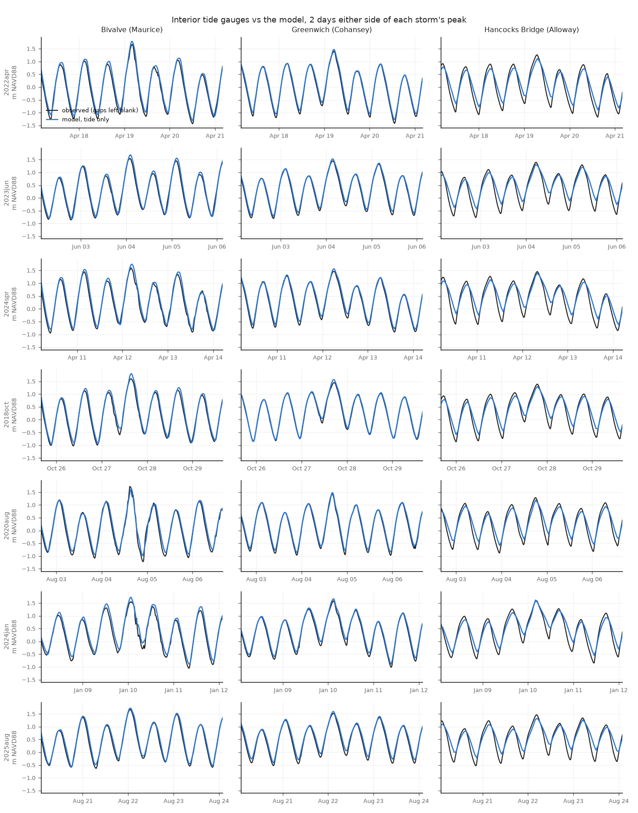

# Storm tides at the interior gauges (e3v2a30brm65_100m_hrrr)

Generated by `scripts/validate_storm_gauges.py --model e3v2a30brm65_100m --suffix _hrrr`. The §33 Sandy check repeated for 7 storm tides
of the storm panel (FINDINGS §37): every observed high tide in each run window against
the model's highest level within ±3 h, runs `<storm>_intact_slr000_hrrr` (tide only) and `_rain_hrrr` (where staged).
Metres NAVD88; diff and bias = model − observed. Highs and lows count only where the record is
complete around them. "storm high" = the model's highest level within a day of the Ship John
peak vs the observed maximum within ±3 h; blank where the gauge was out at that time (it often
is). "map" rows are read hourly, so their storm highs can come out a few cm low. The gauges sit in the creek mouths: they test the water the creeks deliver to the banks,
not flooding on the fields.

## Per storm and gauge

| index | storm | gauge | series | n_highs | bias_all_m | rmse_all_m | bias_top5_m | bias_lows_m | storm_high_obs_m | storm_high_model_m | storm_high_diff_m | rain_adds_m |
|---|---|---|---|---|---|---|---|---|---|---|---|---|
| 0 | storm2022apr | Bivalve (Maurice) | his | 43 | +0.06 | +0.07 | +0.06 | +0.07 | +1.67 | +1.79 | +0.12 | +nan |
| 1 | storm2022apr | Greenwich (Cohansey) | his | 42 | +0.02 | +0.03 | +0.03 | +0.11 | +1.40 | +1.47 | +0.07 | +nan |
| 2 | storm2022apr | Hancocks Bridge (Alloway) | map (channel cell, hourly) | 42 | -0.12 | +0.13 | -0.13 | +0.26 | +1.26 | +1.12 | -0.14 | +nan |
| 3 | storm2023jun | Bivalve (Maurice) | his | 43 | +0.05 | +0.08 | +0.12 | +0.03 | +1.54 | +1.69 | +0.14 | +nan |
| 4 | storm2023jun | Greenwich (Cohansey) | his | 43 | +0.01 | +0.02 | +0.04 | +0.10 | +1.44 | +1.53 | +0.08 | +nan |
| 5 | storm2023jun | Hancocks Bridge (Alloway) | map (channel cell, hourly) | 42 | -0.09 | +0.09 | -0.11 | +0.32 | +1.40 | +1.31 | -0.08 | +nan |
| 6 | storm2024spr | Bivalve (Maurice) | his | 106 | +0.08 | +0.11 | +0.12 | +0.09 | +1.60 | +1.74 | +0.14 | +nan |
| 7 | storm2024spr | Greenwich (Cohansey) | his | 106 | +0.01 | +0.03 | +0.07 | +0.12 | +1.46 | +1.56 | +0.10 | +nan |
| 8 | storm2024spr | Hancocks Bridge (Alloway) | map (channel cell, hourly) | 106 | -0.12 | +0.13 | -0.09 | +0.29 | +1.45 | +1.39 | -0.06 | +nan |
| 9 | storm2018oct | Bivalve (Maurice) | his | 43 | +0.03 | +0.06 | +0.11 | +0.05 | +1.60 | +1.80 | +0.20 | +nan |
| 10 | storm2018oct | Greenwich (Cohansey) | his | 42 | +0.02 | +0.03 | +0.05 | -0.02 | +1.45 | +1.57 | +0.12 | +nan |
| 11 | storm2018oct | Hancocks Bridge (Alloway) | map (channel cell, hourly) | 42 | -0.11 | +0.11 | -0.11 | +0.26 | +1.39 | +1.30 | -0.09 | +nan |
| 12 | storm2020aug | Bivalve (Maurice) | his | 43 | +0.05 | +0.11 | +0.13 | +0.09 | +1.73 | +1.64 | -0.09 | +nan |
| 13 | storm2020aug | Greenwich (Cohansey) | his | 43 | +0.01 | +0.02 | +0.01 | +0.11 | +1.41 | +1.48 | +0.07 | +nan |
| 14 | storm2020aug | Hancocks Bridge (Alloway) | map (channel cell, hourly) | 43 | -0.12 | +0.12 | -0.15 | +0.28 | +1.29 | +1.19 | -0.09 | +nan |
| 15 | storm2024jan | Bivalve (Maurice) | his | 53 | +0.10 | +0.12 | +0.14 | +0.10 | +1.55 | +1.73 | +0.18 | +nan |
| 16 | storm2024jan | Greenwich (Cohansey) | his | 54 | +0.02 | +0.04 | +0.06 | +0.12 | +1.58 | +1.67 | +0.08 | +nan |
| 17 | storm2024jan | Hancocks Bridge (Alloway) | map (channel cell, hourly) | 54 | -0.13 | +0.14 | -0.07 | +0.27 | +1.59 | +1.62 | +0.02 | +nan |
| 18 | storm2025aug | Bivalve (Maurice) | his | 43 | +0.06 | +0.11 | +0.05 | +0.06 | +1.67 | +1.73 | +0.05 | +nan |
| 19 | storm2025aug | Greenwich (Cohansey) | his | 43 | +0.02 | +0.04 | +0.05 | +0.13 | +1.52 | +1.59 | +0.08 | +nan |
| 20 | storm2025aug | Hancocks Bridge (Alloway) | map (channel cell, hourly) | 43 | -0.12 | +0.13 | -0.13 | +0.33 | +1.46 | +1.32 | -0.14 | +nan |

## Mean over the storms

| gauge | bias_all_m | rmse_all_m | bias_top5_m | bias_lows_m | storm_high_diff_m | storms_with_peak_observed |
|---|---|---|---|---|---|---|
| Bivalve (Maurice) | +0.06 | +0.10 | +0.11 | +0.07 | +0.11 | 7 |
| Greenwich (Cohansey) | +0.01 | +0.03 | +0.04 | +0.10 | +0.09 | 7 |
| Hancocks Bridge (Alloway) | -0.12 | +0.12 | -0.11 | +0.29 | -0.09 | 7 |

