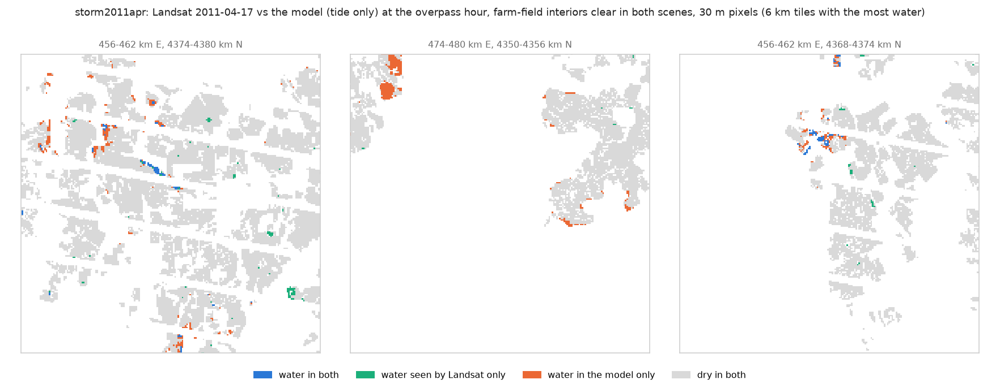
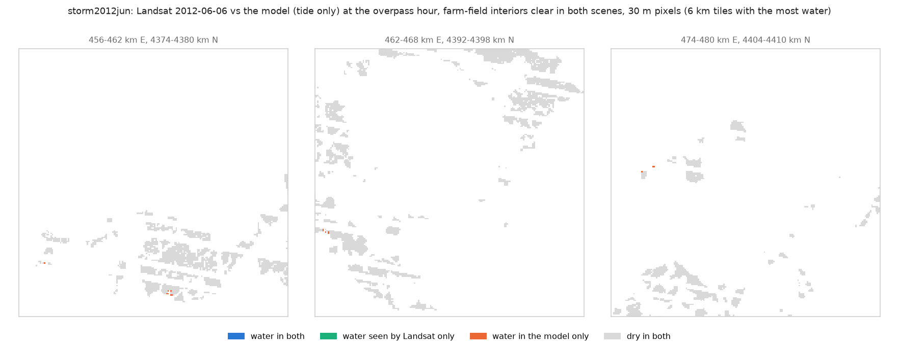
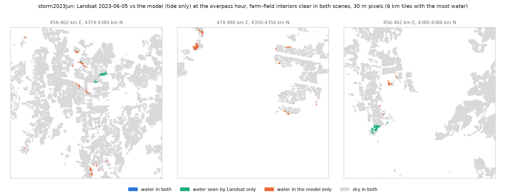

# Spring storm tides: does Landsat see the water the model puts on the fields?

Generated by `scripts/validate_storm_landsat.py` (method in its docstring). Three storms have
a clear Landsat scene within about a day and a half of the peak. Water = MNDWI > 0.0
on farm-field interiors clear in both the storm scene and a pre-storm reference, and not water
in the reference. "found" = share of the water Landsat sees that the model also has;
"confirmed" = share of the model's water that Landsat sees. Model water at the overpass hour is
the fair comparison; the peak is what the storm panel uses.

## Pixels (30 m)

| index | storm | scene | run | model at | fields | scored_ha | observed_ha | model_ha | both_ha | found | confirmed |
|---|---|---|---|---|---|---|---|---|---|---|---|
| 0 | storm2011apr | 2011-04-17 15:33 UTC | tide | overpass | all fields | 65,989.35 | 171.18 | 155.43 | 19.71 | 0.12 | 0.13 |
| 1 | storm2011apr | 2011-04-17 15:33 UTC | tide | overpass | low fields (< 1.5 m above MHHW) | 3,911.31 | 41.22 | 151.38 | 19.62 | 0.48 | 0.13 |
| 2 | storm2011apr | 2011-04-17 15:33 UTC | tide | peak | all fields | 65,989.35 | 171.18 | 650.34 | 29.07 | 0.17 | 0.04 |
| 3 | storm2011apr | 2011-04-17 15:33 UTC | tide | peak | low fields (< 1.5 m above MHHW) | 3,911.31 | 41.22 | 549.18 | 28.35 | 0.69 | 0.05 |
| 4 | storm2011apr | 2011-04-17 15:33 UTC | tide + rain | overpass | all fields | 65,989.35 | 171.18 | 371.34 | 40.68 | 0.24 | 0.11 |
| 5 | storm2011apr | 2011-04-17 15:33 UTC | tide + rain | overpass | low fields (< 1.5 m above MHHW) | 3,911.31 | 41.22 | 206.19 | 24.57 | 0.60 | 0.12 |
| 6 | storm2011apr | 2011-04-17 15:33 UTC | tide + rain | peak | all fields | 65,989.35 | 171.18 | 1,220.67 | 59.49 | 0.35 | 0.05 |
| 7 | storm2011apr | 2011-04-17 15:33 UTC | tide + rain | peak | low fields (< 1.5 m above MHHW) | 3,911.31 | 41.22 | 643.32 | 31.77 | 0.77 | 0.05 |
| 8 | storm2012jun | 2012-06-06 15:34 UTC | tide | overpass | all fields | 4,504.41 | 16.92 | 1.62 | 0.00 | 0.00 | 0.00 |
| 9 | storm2012jun | 2012-06-06 15:34 UTC | tide | overpass | low fields (< 1.5 m above MHHW) | 601.29 | 0.00 | 1.62 | 0.00 | nan | 0.00 |
| 10 | storm2012jun | 2012-06-06 15:34 UTC | tide | peak | all fields | 4,504.41 | 16.92 | 12.96 | 0.00 | 0.00 | 0.00 |
| 11 | storm2012jun | 2012-06-06 15:34 UTC | tide | peak | low fields (< 1.5 m above MHHW) | 601.29 | 0.00 | 12.87 | 0.00 | nan | 0.00 |
| 12 | storm2012jun | 2012-06-06 15:34 UTC | tide + rain | overpass | all fields | 4,504.41 | 16.92 | 1.71 | 0.00 | 0.00 | 0.00 |
| 13 | storm2012jun | 2012-06-06 15:34 UTC | tide + rain | overpass | low fields (< 1.5 m above MHHW) | 601.29 | 0.00 | 1.71 | 0.00 | nan | 0.00 |
| 14 | storm2012jun | 2012-06-06 15:34 UTC | tide + rain | peak | all fields | 4,504.41 | 16.92 | 13.77 | 0.00 | 0.00 | 0.00 |
| 15 | storm2012jun | 2012-06-06 15:34 UTC | tide + rain | peak | low fields (< 1.5 m above MHHW) | 601.29 | 0.00 | 13.41 | 0.00 | nan | 0.00 |
| 16 | storm2023jun | 2023-06-05 15:39 UTC | tide | overpass | all fields | 59,134.14 | 29.52 | 42.03 | 1.17 | 0.04 | 0.03 |
| 17 | storm2023jun | 2023-06-05 15:39 UTC | tide | overpass | low fields (< 1.5 m above MHHW) | 3,502.35 | 10.53 | 41.13 | 1.17 | 0.11 | 0.03 |
| 18 | storm2023jun | 2023-06-05 15:39 UTC | tide | peak | all fields | 59,134.14 | 29.52 | 228.24 | 2.97 | 0.10 | 0.01 |
| 19 | storm2023jun | 2023-06-05 15:39 UTC | tide | peak | low fields (< 1.5 m above MHHW) | 3,502.35 | 10.53 | 195.93 | 2.97 | 0.28 | 0.02 |
| 20 | storm2023jun | 2023-06-05 15:39 UTC | tide + rain | overpass | all fields | 59,134.14 | 29.52 | 42.03 | 1.17 | 0.04 | 0.03 |
| 21 | storm2023jun | 2023-06-05 15:39 UTC | tide + rain | overpass | low fields (< 1.5 m above MHHW) | 3,502.35 | 10.53 | 41.13 | 1.17 | 0.11 | 0.03 |
| 22 | storm2023jun | 2023-06-05 15:39 UTC | tide + rain | peak | all fields | 59,134.14 | 29.52 | 228.24 | 2.97 | 0.10 | 0.01 |
| 23 | storm2023jun | 2023-06-05 15:39 UTC | tide + rain | peak | low fields (< 1.5 m above MHHW) | 3,502.35 | 10.53 | 195.93 | 2.97 | 0.28 | 0.02 |

## Fields (>= 10% of the field's scored pixels wet; >= 3 scored pixels)

| index | storm | model | fields scored | observed flooded | model flooded | both | observed only | model only |
|---|---|---|---|---|---|---|---|---|
| 0 | storm2011apr | tide, overpass | 8935 | 129 | 99 | 22 | 107 | 77 |
| 1 | storm2011apr | tide, peak | 8935 | 129 | 372 | 30 | 99 | 342 |
| 2 | storm2011apr | tide + rain, overpass | 8935 | 129 | 261 | 44 | 85 | 217 |
| 3 | storm2011apr | tide + rain, peak | 8935 | 129 | 836 | 62 | 67 | 774 |
| 4 | storm2012jun | tide, overpass | 893 | 2 | 0 | 0 | 2 | 0 |
| 5 | storm2012jun | tide, peak | 893 | 2 | 13 | 0 | 2 | 13 |
| 6 | storm2012jun | tide + rain, overpass | 893 | 2 | 0 | 0 | 2 | 0 |
| 7 | storm2012jun | tide + rain, peak | 893 | 2 | 14 | 0 | 2 | 14 |
| 8 | storm2023jun | tide, overpass | 7684 | 13 | 37 | 0 | 13 | 37 |
| 9 | storm2023jun | tide, peak | 7684 | 13 | 163 | 3 | 10 | 160 |
| 10 | storm2023jun | tide + rain, overpass | 7684 | 13 | 37 | 0 | 13 | 37 |
| 11 | storm2023jun | tide + rain, peak | 7684 | 13 | 163 | 3 | 10 | 160 |

## By model depth (low fields, tide only, at the overpass hour)

The model's mean depth over each 30 m pixel; "Landsat water" = share of those pixels Landsat
calls water; "MNDWI rise" = mean MNDWI change from the reference scene (wetter = higher).

| index | storm | model depth, m | pixels | Landsat water | MNDWI rise |
|---|---|---|---|---|---|
| 0 | storm2011apr | [0.0, 0.05) | 41660 | 0.006 | 0.061 |
| 1 | storm2011apr | [0.05, 0.15) | 605 | 0.069 | 0.154 |
| 2 | storm2011apr | [0.15, 0.3) | 516 | 0.114 | 0.199 |
| 3 | storm2011apr | [0.3, 0.6) | 403 | 0.184 | 0.233 |
| 4 | storm2011apr | [0.6, inf) | 275 | 0.175 | 0.197 |
| 5 | storm2012jun | [0.0, 0.05) | 6661 | 0.000 | -0.007 |
| 6 | storm2012jun | [0.05, 0.15) | 14 | 0.000 | 0.098 |
| 7 | storm2012jun | [0.15, 0.3) | 5 | 0.000 | -0.041 |
| 8 | storm2012jun | [0.3, 0.6) | 1 | 0.000 | 0.058 |
| 9 | storm2012jun | [0.6, inf) | 0 | nan | nan |
| 10 | storm2023jun | [0.0, 0.05) | 38398 | 0.003 | 0.079 |
| 11 | storm2023jun | [0.05, 0.15) | 261 | 0.000 | 0.085 |
| 12 | storm2023jun | [0.15, 0.3) | 141 | 0.007 | 0.084 |
| 13 | storm2023jun | [0.3, 0.6) | 77 | 0.156 | 0.129 |
| 14 | storm2023jun | [0.6, inf) | 38 | 0.000 | 0.084 |

## Maps (tide-only run at the overpass hour)

## Caveats

- MNDWI sees open water. Water under a crop canopy or in dense stubble is missed, so "found"
  and "confirmed" are lower bounds where fields are vegetated (June more than April).
- Landsat 7 (2011, 2012) has stripes of missing data; those pixels are not scored.
- The scene is hours to a day and a half after the peak; water that drained is gone, water
  that ponds behind banks stays. The model's drainage after the peak is not validated (§16).
- Saturated bare soil can read as water at MNDWI > 0.
