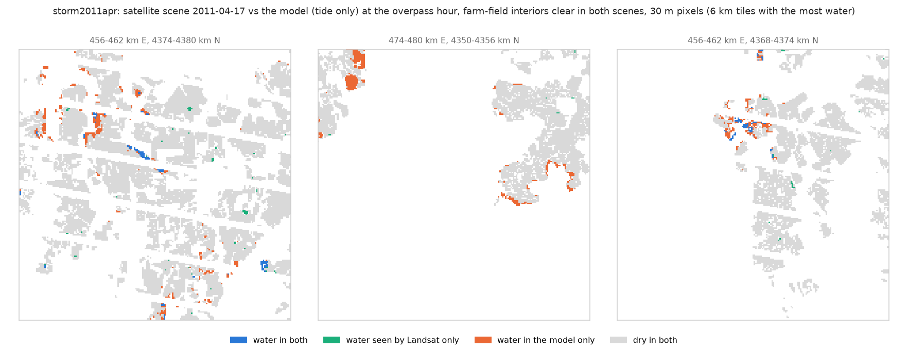
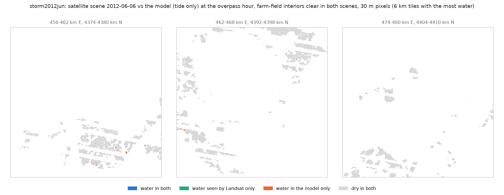
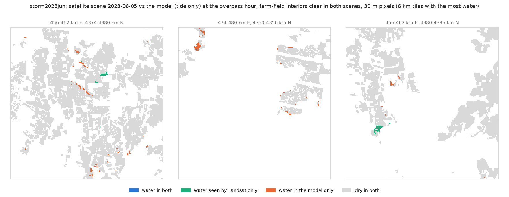
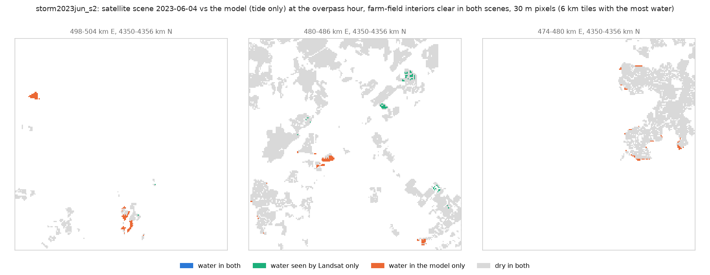
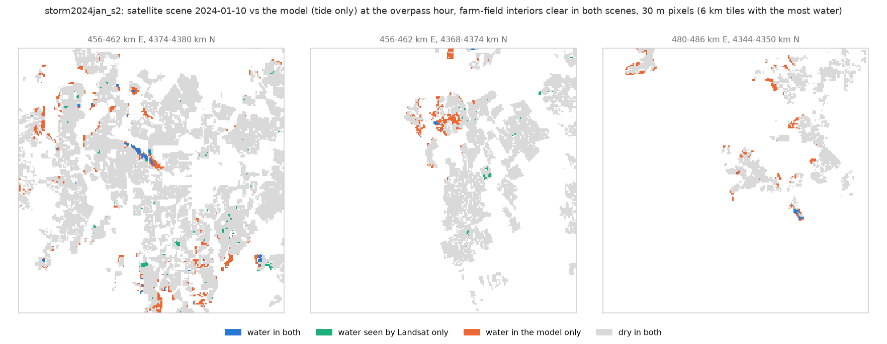
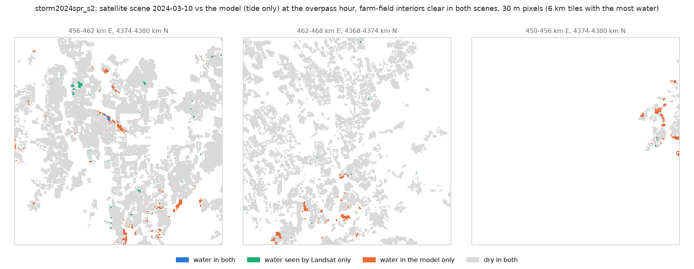
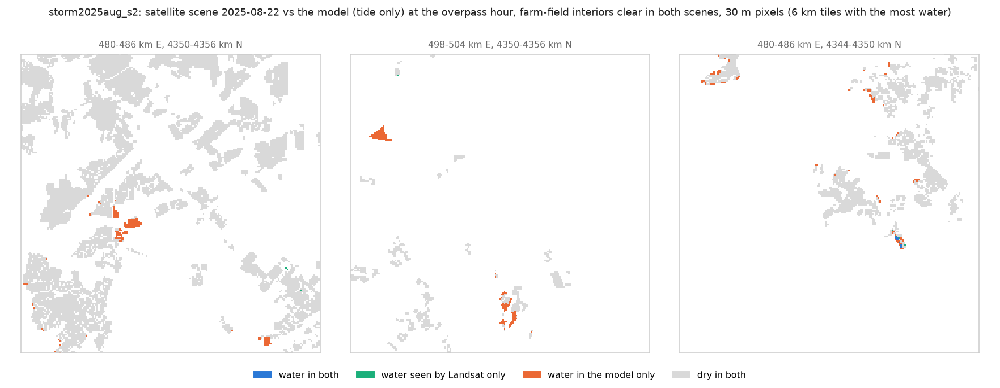

# Spring storm tides: does Landsat see the water the model puts on the fields? (e3v2a30brm65_100m)

Generated by `scripts/validate_storm_landsat.py --model e3v2a30brm65_100m --wind` (method in its docstring). Three storms have
a clear Landsat scene within about a day and a half of the peak; four more have a Sentinel-2 scene ("S2"),
13-14 h after it. Water = MNDWI > 0.0
on farm-field interiors clear in both the storm scene and a pre-storm reference, and not water
in the reference. "found" = share of the water Landsat sees that the model also has;
"confirmed" = share of the model's water that Landsat sees. Model water at the overpass hour is
the fair comparison; the peak is what the storm panel uses.

## Pixels (30 m)

| index | storm | scene | run | model at | fields | scored_ha | observed_ha | model_ha | both_ha | found | confirmed |
|---|---|---|---|---|---|---|---|---|---|---|---|
| 0 | storm2011apr | 2011-04-17 15:33 UTC | tide | overpass | all fields | 65,989.35 | 171.18 | 232.11 | 25.11 | 0.15 | 0.11 |
| 1 | storm2011apr | 2011-04-17 15:33 UTC | tide | overpass | low fields (< 1.5 m above MHHW) | 3,911.31 | 41.22 | 225.72 | 24.39 | 0.59 | 0.11 |
| 2 | storm2011apr | 2011-04-17 15:33 UTC | tide | peak | all fields | 65,989.35 | 171.18 | 956.70 | 33.93 | 0.20 | 0.04 |
| 3 | storm2011apr | 2011-04-17 15:33 UTC | tide | peak | low fields (< 1.5 m above MHHW) | 3,911.31 | 41.22 | 804.51 | 32.31 | 0.78 | 0.04 |
| 4 | storm2011apr | 2011-04-17 15:33 UTC | tide + rain | overpass | all fields | 65,989.35 | 171.18 | 460.26 | 46.35 | 0.27 | 0.10 |
| 5 | storm2011apr | 2011-04-17 15:33 UTC | tide + rain | overpass | low fields (< 1.5 m above MHHW) | 3,911.31 | 41.22 | 285.30 | 29.43 | 0.71 | 0.10 |
| 6 | storm2011apr | 2011-04-17 15:33 UTC | tide + rain | peak | all fields | 65,989.35 | 171.18 | 1,553.13 | 66.15 | 0.39 | 0.04 |
| 7 | storm2011apr | 2011-04-17 15:33 UTC | tide + rain | peak | low fields (< 1.5 m above MHHW) | 3,911.31 | 41.22 | 912.51 | 36.63 | 0.89 | 0.04 |
| 8 | storm2012jun | 2012-06-06 15:34 UTC | tide | overpass | all fields | 4,504.41 | 16.92 | 2.88 | 0.00 | 0.00 | 0.00 |
| 9 | storm2012jun | 2012-06-06 15:34 UTC | tide | overpass | low fields (< 1.5 m above MHHW) | 601.29 | 0.00 | 2.88 | 0.00 | nan | 0.00 |
| 10 | storm2012jun | 2012-06-06 15:34 UTC | tide | peak | all fields | 4,504.41 | 16.92 | 24.75 | 0.00 | 0.00 | 0.00 |
| 11 | storm2012jun | 2012-06-06 15:34 UTC | tide | peak | low fields (< 1.5 m above MHHW) | 601.29 | 0.00 | 24.57 | 0.00 | nan | 0.00 |
| 12 | storm2012jun | 2012-06-06 15:34 UTC | tide + rain | overpass | all fields | 4,504.41 | 16.92 | 2.97 | 0.00 | 0.00 | 0.00 |
| 13 | storm2012jun | 2012-06-06 15:34 UTC | tide + rain | overpass | low fields (< 1.5 m above MHHW) | 601.29 | 0.00 | 2.97 | 0.00 | nan | 0.00 |
| 14 | storm2012jun | 2012-06-06 15:34 UTC | tide + rain | peak | all fields | 4,504.41 | 16.92 | 25.65 | 0.00 | 0.00 | 0.00 |
| 15 | storm2012jun | 2012-06-06 15:34 UTC | tide + rain | peak | low fields (< 1.5 m above MHHW) | 601.29 | 0.00 | 25.11 | 0.00 | nan | 0.00 |
| 16 | storm2023jun | 2023-06-05 15:39 UTC | tide | overpass | all fields | 59,134.14 | 29.52 | 51.93 | 1.17 | 0.04 | 0.02 |
| 17 | storm2023jun | 2023-06-05 15:39 UTC | tide | overpass | low fields (< 1.5 m above MHHW) | 3,502.35 | 10.53 | 50.85 | 1.17 | 0.11 | 0.02 |
| 18 | storm2023jun | 2023-06-05 15:39 UTC | tide | peak | all fields | 59,134.14 | 29.52 | 287.91 | 3.06 | 0.10 | 0.01 |
| 19 | storm2023jun | 2023-06-05 15:39 UTC | tide | peak | low fields (< 1.5 m above MHHW) | 3,502.35 | 10.53 | 246.96 | 3.06 | 0.29 | 0.01 |
| 20 | storm2023jun | 2023-06-05 15:39 UTC | tide + rain | overpass | all fields | 59,134.14 | 29.52 | 51.93 | 1.17 | 0.04 | 0.02 |
| 21 | storm2023jun | 2023-06-05 15:39 UTC | tide + rain | overpass | low fields (< 1.5 m above MHHW) | 3,502.35 | 10.53 | 50.85 | 1.17 | 0.11 | 0.02 |
| 22 | storm2023jun | 2023-06-05 15:39 UTC | tide + rain | peak | all fields | 59,134.14 | 29.52 | 287.91 | 3.06 | 0.10 | 0.01 |
| 23 | storm2023jun | 2023-06-05 15:39 UTC | tide + rain | peak | low fields (< 1.5 m above MHHW) | 3,502.35 | 10.53 | 246.96 | 3.06 | 0.29 | 0.01 |
| 24 | storm2023jun S2 | 2023-06-04 15:49 UTC | tide | overpass | all fields | 16,665.57 | 42.48 | 35.55 | 0.09 | 0.00 | 0.00 |
| 25 | storm2023jun S2 | 2023-06-04 15:49 UTC | tide | overpass | low fields (< 1.5 m above MHHW) | 599.40 | 0.27 | 35.55 | 0.09 | 0.33 | 0.00 |
| 26 | storm2023jun S2 | 2023-06-04 15:49 UTC | tide | peak | all fields | 16,665.57 | 42.48 | 104.76 | 0.09 | 0.00 | 0.00 |
| 27 | storm2023jun S2 | 2023-06-04 15:49 UTC | tide | peak | low fields (< 1.5 m above MHHW) | 599.40 | 0.27 | 99.36 | 0.09 | 0.33 | 0.00 |
| 28 | storm2023jun S2 | 2023-06-04 15:49 UTC | tide + rain | overpass | all fields | 16,665.57 | 42.48 | 35.55 | 0.09 | 0.00 | 0.00 |
| 29 | storm2023jun S2 | 2023-06-04 15:49 UTC | tide + rain | overpass | low fields (< 1.5 m above MHHW) | 599.40 | 0.27 | 35.55 | 0.09 | 0.33 | 0.00 |
| 30 | storm2023jun S2 | 2023-06-04 15:49 UTC | tide + rain | peak | all fields | 16,665.57 | 42.48 | 104.76 | 0.09 | 0.00 | 0.00 |
| 31 | storm2023jun S2 | 2023-06-04 15:49 UTC | tide + rain | peak | low fields (< 1.5 m above MHHW) | 599.40 | 0.27 | 99.36 | 0.09 | 0.33 | 0.00 |
| 32 | storm2024jan S2 | 2024-01-10 15:56 UTC | tide | overpass | all fields | 67,985.64 | 352.17 | 306.09 | 18.27 | 0.05 | 0.06 |
| 33 | storm2024jan S2 | 2024-01-10 15:56 UTC | tide | overpass | low fields (< 1.5 m above MHHW) | 4,095.36 | 39.51 | 282.96 | 17.37 | 0.44 | 0.06 |
| 34 | storm2024jan S2 | 2024-01-10 15:56 UTC | tide | peak | all fields | 67,985.64 | 352.17 | 877.68 | 23.13 | 0.07 | 0.03 |
| 35 | storm2024jan S2 | 2024-01-10 15:56 UTC | tide | peak | low fields (< 1.5 m above MHHW) | 4,095.36 | 39.51 | 745.56 | 21.24 | 0.54 | 0.03 |
| 36 | storm2024jan S2 | 2024-01-10 15:56 UTC | tide + rain | overpass | all fields | 67,985.64 | 352.17 | 459.99 | 33.21 | 0.09 | 0.07 |
| 37 | storm2024jan S2 | 2024-01-10 15:56 UTC | tide + rain | overpass | low fields (< 1.5 m above MHHW) | 4,095.36 | 39.51 | 333.45 | 19.17 | 0.49 | 0.06 |
| 38 | storm2024jan S2 | 2024-01-10 15:56 UTC | tide + rain | peak | all fields | 67,985.64 | 352.17 | 1,175.58 | 44.46 | 0.13 | 0.04 |
| 39 | storm2024jan S2 | 2024-01-10 15:56 UTC | tide + rain | peak | low fields (< 1.5 m above MHHW) | 4,095.36 | 39.51 | 827.28 | 23.67 | 0.60 | 0.03 |
| 40 | storm2024spr S2 | 2024-03-10 15:50 UTC | tide | overpass | all fields | 41,967.54 | 136.35 | 75.69 | 2.52 | 0.02 | 0.03 |
| 41 | storm2024spr S2 | 2024-03-10 15:50 UTC | tide | overpass | low fields (< 1.5 m above MHHW) | 2,778.48 | 12.87 | 70.92 | 2.52 | 0.20 | 0.04 |
| 42 | storm2024spr S2 | 2024-03-10 15:50 UTC | tide | peak | all fields | 41,967.54 | 136.35 | 347.76 | 7.92 | 0.06 | 0.02 |
| 43 | storm2024spr S2 | 2024-03-10 15:50 UTC | tide | peak | low fields (< 1.5 m above MHHW) | 2,778.48 | 12.87 | 296.01 | 7.74 | 0.60 | 0.03 |
| 44 | storm2024spr S2 | 2024-03-10 15:50 UTC | tide + rain | overpass | all fields | 41,967.54 | 136.35 | 98.19 | 3.87 | 0.03 | 0.04 |
| 45 | storm2024spr S2 | 2024-03-10 15:50 UTC | tide + rain | overpass | low fields (< 1.5 m above MHHW) | 2,778.48 | 12.87 | 78.48 | 3.06 | 0.24 | 0.04 |
| 46 | storm2024spr S2 | 2024-03-10 15:50 UTC | tide + rain | peak | all fields | 41,967.54 | 136.35 | 723.06 | 17.46 | 0.13 | 0.02 |
| 47 | storm2024spr S2 | 2024-03-10 15:50 UTC | tide + rain | peak | low fields (< 1.5 m above MHHW) | 2,778.48 | 12.87 | 367.65 | 8.55 | 0.66 | 0.02 |
| 48 | storm2025aug S2 | 2025-08-22 15:49 UTC | tide | overpass | all fields | 18,528.84 | 29.34 | 56.52 | 0.81 | 0.03 | 0.01 |
| 49 | storm2025aug S2 | 2025-08-22 15:49 UTC | tide | overpass | low fields (< 1.5 m above MHHW) | 763.65 | 1.35 | 56.43 | 0.81 | 0.60 | 0.01 |
| 50 | storm2025aug S2 | 2025-08-22 15:49 UTC | tide | peak | all fields | 18,528.84 | 29.34 | 163.98 | 1.26 | 0.04 | 0.01 |
| 51 | storm2025aug S2 | 2025-08-22 15:49 UTC | tide | peak | low fields (< 1.5 m above MHHW) | 763.65 | 1.35 | 153.09 | 1.26 | 0.93 | 0.01 |
| 52 | storm2025aug S2 | 2025-08-22 15:49 UTC | tide + rain | overpass | all fields | 18,528.84 | 29.34 | 63.27 | 0.81 | 0.03 | 0.01 |
| 53 | storm2025aug S2 | 2025-08-22 15:49 UTC | tide + rain | overpass | low fields (< 1.5 m above MHHW) | 763.65 | 1.35 | 56.52 | 0.81 | 0.60 | 0.01 |
| 54 | storm2025aug S2 | 2025-08-22 15:49 UTC | tide + rain | peak | all fields | 18,528.84 | 29.34 | 174.24 | 1.26 | 0.04 | 0.01 |
| 55 | storm2025aug S2 | 2025-08-22 15:49 UTC | tide + rain | peak | low fields (< 1.5 m above MHHW) | 763.65 | 1.35 | 153.27 | 1.26 | 0.93 | 0.01 |

## Fields (>= 10% of the field's scored pixels wet; >= 3 scored pixels)

| index | storm | model | fields scored | observed flooded | model flooded | both | observed only | model only |
|---|---|---|---|---|---|---|---|---|
| 0 | storm2011apr | tide, overpass | 8935 | 129 | 139 | 24 | 105 | 115 |
| 1 | storm2011apr | tide, peak | 8935 | 129 | 494 | 32 | 97 | 462 |
| 2 | storm2011apr | tide + rain, overpass | 8935 | 129 | 304 | 49 | 80 | 255 |
| 3 | storm2011apr | tide + rain, peak | 8935 | 129 | 955 | 66 | 63 | 889 |
| 4 | storm2012jun | tide, overpass | 893 | 2 | 2 | 0 | 2 | 2 |
| 5 | storm2012jun | tide, peak | 893 | 2 | 19 | 0 | 2 | 19 |
| 6 | storm2012jun | tide + rain, overpass | 893 | 2 | 2 | 0 | 2 | 2 |
| 7 | storm2012jun | tide + rain, peak | 893 | 2 | 22 | 0 | 2 | 22 |
| 8 | storm2023jun | tide, overpass | 7684 | 13 | 44 | 0 | 13 | 44 |
| 9 | storm2023jun | tide, peak | 7684 | 13 | 201 | 3 | 10 | 198 |
| 10 | storm2023jun | tide + rain, overpass | 7684 | 13 | 44 | 0 | 13 | 44 |
| 11 | storm2023jun | tide + rain, peak | 7684 | 13 | 201 | 3 | 10 | 198 |
| 12 | storm2023jun S2 | tide, overpass | 3279 | 25 | 20 | 0 | 25 | 20 |
| 13 | storm2023jun S2 | tide, peak | 3279 | 25 | 61 | 0 | 25 | 61 |
| 14 | storm2023jun S2 | tide + rain, overpass | 3279 | 25 | 20 | 0 | 25 | 20 |
| 15 | storm2023jun S2 | tide + rain, peak | 3279 | 25 | 61 | 0 | 25 | 61 |
| 16 | storm2024jan S2 | tide, overpass | 8964 | 234 | 209 | 16 | 218 | 193 |
| 17 | storm2024jan S2 | tide, peak | 8964 | 234 | 466 | 17 | 217 | 449 |
| 18 | storm2024jan S2 | tide + rain, overpass | 8964 | 234 | 341 | 32 | 202 | 309 |
| 19 | storm2024jan S2 | tide + rain, peak | 8964 | 234 | 747 | 45 | 189 | 702 |
| 20 | storm2024spr S2 | tide, overpass | 4880 | 123 | 68 | 4 | 119 | 64 |
| 21 | storm2024spr S2 | tide, peak | 4880 | 123 | 206 | 8 | 115 | 198 |
| 22 | storm2024spr S2 | tide + rain, overpass | 4880 | 123 | 97 | 10 | 113 | 87 |
| 23 | storm2024spr S2 | tide + rain, peak | 4880 | 123 | 495 | 19 | 104 | 476 |
| 24 | storm2025aug S2 | tide, overpass | 3782 | 34 | 34 | 1 | 33 | 33 |
| 25 | storm2025aug S2 | tide, peak | 3782 | 34 | 95 | 1 | 33 | 94 |
| 26 | storm2025aug S2 | tide + rain, overpass | 3782 | 34 | 41 | 1 | 33 | 40 |
| 27 | storm2025aug S2 | tide + rain, peak | 3782 | 34 | 107 | 1 | 33 | 106 |

## By model depth (low fields, tide only, at the overpass hour)

The model's mean depth over each 30 m pixel; "Landsat water" = share of those pixels Landsat
calls water; "MNDWI rise" = mean MNDWI change from the reference scene (wetter = higher).

| index | storm | model depth, m | pixels | Landsat water | MNDWI rise |
|---|---|---|---|---|---|
| 0 | storm2011apr | [0.0, 0.05) | 40778 | 0.005 | 0.059 |
| 1 | storm2011apr | [0.05, 0.15) | 816 | 0.056 | 0.137 |
| 2 | storm2011apr | [0.15, 0.3) | 746 | 0.088 | 0.170 |
| 3 | storm2011apr | [0.3, 0.6) | 686 | 0.095 | 0.184 |
| 4 | storm2011apr | [0.6, inf) | 433 | 0.219 | 0.254 |
| 5 | storm2012jun | [0.0, 0.05) | 6646 | 0.000 | -0.007 |
| 6 | storm2012jun | [0.05, 0.15) | 21 | 0.000 | 0.082 |
| 7 | storm2012jun | [0.15, 0.3) | 12 | 0.000 | 0.013 |
| 8 | storm2012jun | [0.3, 0.6) | 2 | 0.000 | 0.004 |
| 9 | storm2012jun | [0.6, inf) | 0 | nan | nan |
| 10 | storm2023jun | [0.0, 0.05) | 38275 | 0.003 | 0.079 |
| 11 | storm2023jun | [0.05, 0.15) | 321 | 0.000 | 0.085 |
| 12 | storm2023jun | [0.15, 0.3) | 170 | 0.000 | 0.082 |
| 13 | storm2023jun | [0.3, 0.6) | 103 | 0.107 | 0.126 |
| 14 | storm2023jun | [0.6, inf) | 46 | 0.043 | 0.089 |
| 15 | storm2023jun S2 | [0.0, 0.05) | 6215 | 0.000 | -0.093 |
| 16 | storm2023jun S2 | [0.05, 0.15) | 121 | 0.000 | -0.141 |
| 17 | storm2023jun S2 | [0.15, 0.3) | 102 | 0.010 | -0.107 |
| 18 | storm2023jun S2 | [0.3, 0.6) | 71 | 0.000 | -0.146 |
| 19 | storm2023jun S2 | [0.6, inf) | 151 | 0.000 | -0.231 |
| 20 | storm2024jan S2 | [0.0, 0.05) | 42166 | 0.006 | 0.045 |
| 21 | storm2024jan S2 | [0.05, 0.15) | 1087 | 0.047 | 0.104 |
| 22 | storm2024jan S2 | [0.15, 0.3) | 1003 | 0.072 | 0.134 |
| 23 | storm2024jan S2 | [0.3, 0.6) | 781 | 0.059 | 0.130 |
| 24 | storm2024jan S2 | [0.6, inf) | 467 | 0.056 | 0.134 |
| 25 | storm2024spr S2 | [0.0, 0.05) | 30036 | 0.004 | 0.049 |
| 26 | storm2024spr S2 | [0.05, 0.15) | 359 | 0.039 | 0.099 |
| 27 | storm2024spr S2 | [0.15, 0.3) | 260 | 0.042 | 0.083 |
| 28 | storm2024spr S2 | [0.3, 0.6) | 126 | 0.000 | 0.045 |
| 29 | storm2024spr S2 | [0.6, inf) | 91 | 0.011 | 0.108 |
| 30 | storm2025aug S2 | [0.0, 0.05) | 7808 | 0.001 | -0.071 |
| 31 | storm2025aug S2 | [0.05, 0.15) | 150 | 0.027 | -0.016 |
| 32 | storm2025aug S2 | [0.15, 0.3) | 169 | 0.030 | 0.006 |
| 33 | storm2025aug S2 | [0.3, 0.6) | 120 | 0.000 | -0.042 |
| 34 | storm2025aug S2 | [0.6, inf) | 238 | 0.000 | -0.058 |

## Maps (tide-only run at the overpass hour)

## Caveats

- MNDWI sees open water. Water under a crop canopy or in dense stubble is missed, so "found"
  and "confirmed" are lower bounds where fields are vegetated (June more than April).
- Sentinel-2 scenes 2024-01-10 and 2024-03-10 are partly cloudy or cover only the southern tiles.
- Landsat 7 (2011, 2012) has stripes of missing data; those pixels are not scored.
- The scene is hours to a day and a half after the peak; water that drained is gone, water
  that ponds behind banks stays. The model's drainage after the peak is not validated (§16).
- Saturated bare soil can read as water at MNDWI > 0.
