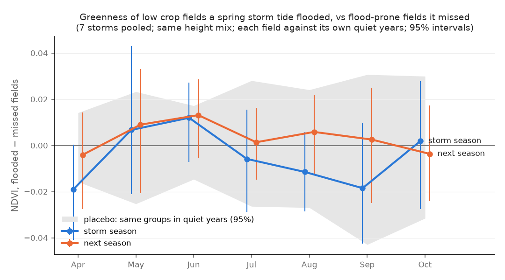

# Greenness after a spring storm tide (preliminary)

Generated by `scripts/storm_ndvi.py`. Question: in the summer after a spring storm tide floods a
low crop field, is the field less green than flood-prone fields the same storm missed?
Greenness is Landsat NDVI (0-1; a full summer crop canopy here reads ~0.8-0.9).

Same design as `reports/storm_panel.md` (FINDINGS §37): the 7 modelled spring storm tides, the
low non-chronic crop fields, flooded vs flood-prone fields the storm missed at the same height
mix, each field measured against its own quiet years (no modelled storm: 2008, 2009, 2015, 2017, 2018, 2020, 2021, 2025;
within 5 years). 631 of 943 fields match a Landsat field unit (98% of the area; 287 flood-prone). The other 312 are too small for a clean 30 m pixel (median 0.3 ha).
Outcomes: **peak** = 90th percentile of clear June-September scenes; **jul_aug** = mean of
clear July-August scenes. Numbers are NDVI, flooded minus missed; brackets are 95% intervals from
resampling fields. Typical flood-prone field in a quiet year: peak 0.80
(the field's own year-to-year SD 0.052, median).

**Placebo.** The resampling interval sees only field-to-field noise. To see year-to-year noise,
each storm's two groups are compared in each nearby quiet year instead (no storm). If storms
mattered, the real estimates should sit outside the placebo range.

## Per storm (tide only, vs prone-dry)

| storm | n_flooded | n_comparison | jul_aug same season | peak same season | jul_aug next season | peak next season | placebo range, jul_aug | placebo range, peak |
|---|---|---|---|---|---|---|---|---|
| storm2010mar | 69 | 193 | +0.004 [-0.031, +0.043] | -0.006 [-0.039, +0.031] | +0.004 [-0.031, +0.041] | -0.011 [-0.037, +0.022] | -0.027 … +0.052 | -0.029 … +0.038 |
| storm2011apr | 186 | 76 | -0.009 [-0.047, +0.033] | -0.015 [-0.054, +0.021] | +0.010 [-0.026, +0.054] | -0.001 [-0.031, +0.032] | -0.037 … +0.048 | -0.032 … +0.022 |
| storm2012jun | 70 | 192 | -0.008 [-0.048, +0.039] | -0.009 [-0.033, +0.016] | +0.018 [-0.018, +0.051] | +0.010 [-0.024, +0.044] | -0.053 … +0.034 | -0.038 … +0.037 |
| storm2014apr | 82 | 180 | +0.022 [-0.008, +0.053] | +0.032 [+0.007, +0.052] | +0.026 [-0.002, +0.049] | +0.025 [+0.002, +0.047] | -0.049 … +0.034 | -0.033 … +0.034 |
| storm2022apr | 25 | 237 | -0.047 [-0.107, +0.010] | -0.037 [-0.076, -0.003] | -0.063 [-0.152, -0.009] | -0.024 [-0.118, +0.039] | -0.038 … +0.024 | -0.028 … +0.032 |
| storm2023jun | 75 | 187 | -0.017 [-0.065, +0.029] | +0.002 [-0.042, +0.042] | +0.029 [-0.006, +0.066] | +0.019 [-0.010, +0.050] | -0.028 … +0.013 | -0.016 … +0.014 |
| storm2024spr | 108 | 154 | +0.014 [-0.009, +0.040] | +0.001 [-0.016, +0.027] | -0.016 [-0.046, +0.017] | -0.002 [-0.037, +0.025] | -0.024 … +0.035 | -0.005 … +0.008 |
| all | nan | nan | -0.006 [-0.022, +0.010] | -0.005 [-0.020, +0.007] | +0.001 [-0.015, +0.016] | +0.002 [-0.015, +0.017] | nan | nan |

## Pooled, every variant

k = 0 is the storm season, 1 the next. "deep" = flooded with a peak depth of at least 0.25 m
(about the deepest quarter), against the same comparisons (fields the storm did not flood at all).

| flooded by | comparison | k | peak | jul_aug |
|---|---|---|---|---|
| deep | never | 0 | -0.009 [-0.063, +0.023] | -0.012 [-0.064, +0.021] |
| deep | never | 1 | +0.012 [+0.002, +0.032] | -0.011 [-0.027, +0.021] |
| deep | prone-dry | 0 | -0.004 [-0.046, +0.035] | -0.007 [-0.042, +0.036] |
| deep | prone-dry | 1 | +0.016 [+0.004, +0.038] | +0.001 [-0.013, +0.027] |
| rain | never | 0 | -0.025 [-0.037, -0.013] | -0.031 [-0.043, -0.017] |
| rain | never | 1 | -0.004 [-0.018, +0.009] | -0.015 [-0.029, +0.000] |
| rain | prone-dry | 0 | -0.003 [-0.015, +0.009] | -0.009 [-0.023, +0.007] |
| rain | prone-dry | 1 | +0.009 [-0.003, +0.020] | +0.003 [-0.009, +0.017] |
| tide | never | 0 | -0.022 [-0.036, -0.009] | -0.026 [-0.041, -0.009] |
| tide | never | 1 | -0.008 [-0.025, +0.006] | -0.021 [-0.037, -0.005] |
| tide | prone-dry | 0 | -0.005 [-0.020, +0.007] | -0.006 [-0.022, +0.010] |
| tide | prone-dry | 1 | +0.002 [-0.015, +0.017] | +0.001 [-0.015, +0.016] |

## Placebo spread (tide-flooded groups)

95% range of the 7-storm average when each storm is replaced by one of its nearby quiet years,
per comparison; sd = spread of single-storm placebo estimates. A pooled estimate inside this
range is what two groups of fields differ by in an ordinary year.

| outcome | prone-dry | never |
|---|---|---|
| peak | [-0.016, +0.017] (sd 0.023) | [-0.014, +0.016] (sd 0.020) |
| jul_aug | [-0.021, +0.023] (sd 0.029) | [-0.021, +0.023] (sd 0.031) |
| m04 | [-0.016, +0.014] (sd 0.023) | [-0.024, +0.028] (sd 0.038) |
| m05 | [-0.025, +0.023] (sd 0.036) | [-0.042, +0.046] (sd 0.062) |
| m06 | [-0.015, +0.017] (sd 0.022) | [-0.024, +0.028] (sd 0.035) |
| m07 | [-0.026, +0.028] (sd 0.036) | [-0.024, +0.026] (sd 0.036) |
| m08 | [-0.027, +0.024] (sd 0.037) | [-0.027, +0.022] (sd 0.036) |
| m09 | [-0.043, +0.031] (sd 0.053) | [-0.035, +0.026] (sd 0.049) |
| m10 | [-0.032, +0.030] (sd 0.044) | [-0.033, +0.040] (sd 0.052) |

## Month by month (tide, prone-dry, 7 storms pooled)

| outcome | storm season | next season |
|---|---|---|
| m04 | -0.019 [-0.041, +0.000] | -0.004 [-0.028, +0.014] |
| m05 | +0.007 [-0.021, +0.043] (6 storms) | +0.009 [-0.021, +0.033] (6 storms) |
| m06 | +0.012 [-0.007, +0.027] | +0.013 [-0.005, +0.029] |
| m07 | -0.006 [-0.029, +0.016] | +0.001 [-0.015, +0.016] |
| m08 | -0.011 [-0.029, +0.006] | +0.006 [-0.013, +0.022] |
| m09 | -0.019 [-0.042, +0.010] | +0.003 [-0.025, +0.025] |
| m10 | +0.002 [-0.028, +0.028] | -0.004 [-0.024, +0.017] |

## Caveats

- **The "never" comparison rests on few fields.** Height-reweighted to the flooded fields' mix,
  the never-flooded group is worth a median of 16 fields per storm (36 for
  prone-dry): few never-flooded fields are as low as the flooded ones, as in FINDINGS §37.
- Flooded = the model's peak (≥ 10% of the field > 5 cm), dikes as built today; banks repaired
  after a storm are not dated (storm panel README).
- 2012 has only Landsat 7 (striped, fewer scenes); sensor changes hit both groups alike.
- The June 2012 and June 2023 storms come after most planting; the April-May months of those years
  are before the storm.
- Cloud masks miss thin haze: monthly means carry it, the 90th-percentile peak mostly does not.
- NDVI is greenness, not yield. A lower June value can be late planting that catches up.
