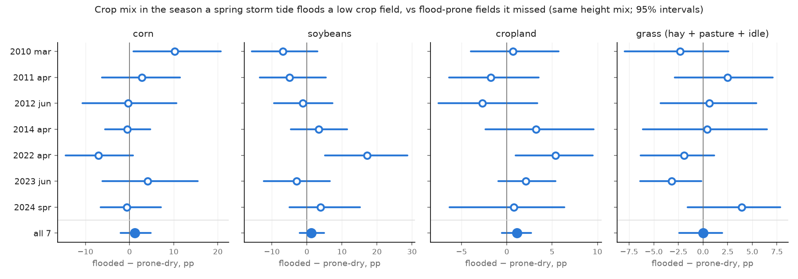

# Storm panel: crop mix in the season a spring storm tide floods a field

Generated by `scripts/plot_storm_panel.py` (FINDINGS §37). Descriptive; no model fits.

**Fields:** 943 low crop fields (LU/LC farm 2012, < 1.5 m above MHHW, at least half cropland
2008-12), not flooded by ordinary spring tides. 417 are flooded by at least one of the 12
modelled storm tides; 526 by none.

**Comparison:** in each spring-storm year, the fields that storm floods (tide only) against
flood-prone fields it missed, reweighted to the same height mix. Each field's share is
measured against its own mean in nearby quiet years (no modelled storm: 2008, 2009, 2015, 2017, 2018, 2020, 2021, 2025;
within 5 years). Numbers are percentage points of field area, flooded minus
comparison, with 95% intervals from resampling fields.

## Same season, per storm (tide only, vs prone-dry)

| storm | n_flooded | n_comparison | corn | soybeans | cropland | grass (hay + pasture + idle) |
|---|---|---|---|---|---|---|
| storm2010mar | 122 | 295 | +10.2 [+0.9, +20.7] | -6.8 [-15.7, +3.0] | +0.7 [-4.0, +5.7] | -2.3 [-7.9, +2.6] |
| storm2011apr | 301 | 116 | +2.7 [-6.2, +11.5] | -5.0 [-13.4, +5.4] | -1.8 [-6.4, +3.5] | +2.5 [-2.9, +7.1] |
| storm2012jun | 120 | 297 | -0.3 [-10.6, +10.6] | -1.1 [-9.4, +7.3] | -2.7 [-7.6, +3.4] | +0.6 [-4.3, +5.4] |
| storm2014apr | 144 | 273 | -0.5 [-5.5, +4.7] | +3.4 [-4.5, +11.5] | +3.2 [-2.4, +9.6] | +0.4 [-6.1, +6.5] |
| storm2022apr | 38 | 379 | -7.1 [-14.5, +0.8] | +17.2 [+5.2, +28.7] | +5.4 [+1.0, +9.5] | -1.9 [-6.3, +1.1] |
| storm2023jun | 131 | 286 | +4.1 [-6.1, +15.5] | -3.0 [-12.3, +6.5] | +2.1 [-0.9, +5.4] | -3.2 [-6.4, -0.2] |
| storm2024spr | 178 | 239 | -0.7 [-6.6, +7.1] | +3.9 [-4.9, +15.2] | +0.8 [-6.3, +6.3] | +3.9 [-1.5, +7.8] |
| all | nan | nan | +1.2 [-2.0, +4.8] | +1.2 [-2.0, +4.9] | +1.1 [-0.6, +2.7] | +0.0 [-2.4, +2.0] |

## All 7 storms, the variants

k = 0: the season of the storm; k = 1: the next season. "never" = fields no modelled storm
floods (height-reweighted). "rain" = flooded counting the storm's rain. "incl. chronic" = the
100 fields wet on ordinary spring tides put back (83 of them flood in all 12 storms, so
they are almost always in the flooded group).

| flooded by | comparison | k | corn | soybeans | cropland | grass (hay + pasture + idle) |
|---|---|---|---|---|---|---|
| rain | never | 0 | +1.7 [-1.1, +4.9] | -0.5 [-3.7, +2.7] | -0.3 [-2.1, +1.9] | -0.1 [-2.1, +1.8] |
| rain | never | 1 | -1.2 [-3.6, +1.6] | +0.8 [-2.1, +3.7] | -4.3 [-6.1, -2.2] | +0.8 [-0.9, +2.2] |
| rain | prone-dry | 0 | -0.3 [-4.6, +3.7] | +1.1 [-2.1, +4.9] | +1.3 [-0.9, +3.7] | +0.2 [-1.9, +2.4] |
| rain | prone-dry | 1 | +0.3 [-2.5, +2.9] | +1.2 [-2.0, +4.5] | +0.1 [-2.2, +2.3] | +0.6 [-1.3, +2.4] |
| tide | never | 0 | +2.1 [-0.7, +5.4] | +1.6 [-1.6, +4.9] | +0.2 [-2.2, +2.8] | -1.2 [-3.2, +0.5] |
| tide | never | 1 | -0.9 [-3.8, +1.9] | -0.5 [-3.5, +2.6] | -4.1 [-6.5, -2.0] | +1.1 [-0.9, +2.8] |
| tide | never, incl. chronic | 0 | -0.2 [-2.7, +2.4] | +2.1 [-1.4, +4.9] | -1.9 [-3.8, +0.6] | -1.8 [-3.5, +0.1] |
| tide | never, incl. chronic | 1 | -2.9 [-5.0, -0.4] | +0.6 [-2.3, +3.3] | -4.7 [-6.9, -2.6] | -0.0 [-1.6, +1.5] |
| tide | prone-dry | 0 | +1.2 [-2.0, +4.8] | +1.2 [-2.0, +4.9] | +1.1 [-0.6, +2.7] | +0.0 [-2.4, +2.0] |
| tide | prone-dry | 1 | +0.3 [-2.8, +3.0] | +1.6 [-1.7, +5.5] | +0.8 [-1.6, +2.9] | +1.5 [-0.7, +3.5] |
| tide | prone-dry, incl. chronic | 0 | -2.2 [-5.2, +0.8] | +3.1 [+0.5, +5.9] | -0.2 [-2.0, +1.6] | -0.5 [-2.6, +1.6] |
| tide | prone-dry, incl. chronic | 1 | -2.3 [-4.8, +0.3] | +3.0 [+0.0, +5.8] | +0.2 [-2.2, +2.4] | +0.5 [-1.8, +2.6] |

## Yes/no per field: did it change crop, did it leave cropland?

Same comparison, with a yes/no outcome per field instead of a share: **main crop changed** (the
field's largest land use differs from the year before) and **left cropland** (at least half
cropland the year before, under half that year and the next). Numbers are percentage points of
the chance, flooded minus comparison. Outcome years from 2024 on are left out (CDL's
product change), so the pooled rows use 6 storms for k = 0 and 5 for k = 1.
Usual yearly rates on the flood-prone fields in quiet years: main crop changed 51%, left cropland 1%.

| flooded by | comparison | k | main crop changed | left cropland |
|---|---|---|---|---|
| rain | never | 0 | +15.4 [+1.4, +29.9] | -1.2 [-3.5, +0.7] |
| rain | never | 1 | +8.7 [-2.9, +20.3] | +0.3 [-4.2, +4.7] |
| rain | prone-dry | 0 | +6.9 [-8.1, +19.2] | -1.4 [-2.8, +0.1] |
| rain | prone-dry | 1 | +2.6 [-9.4, +13.3] | +0.3 [-3.9, +4.9] |
| tide | never | 0 | +20.6 [+4.7, +34.7] | -1.3 [-3.7, +0.8] |
| tide | never | 1 | +13.2 [+0.0, +26.8] | +0.3 [-4.3, +5.1] |
| tide | never, incl. chronic | 0 | +20.4 [+5.3, +32.3] | +0.5 [-2.0, +2.9] |
| tide | never, incl. chronic | 1 | +14.7 [+3.1, +24.6] | +0.8 [-3.2, +5.2] |
| tide | prone-dry | 0 | +4.7 [-5.9, +14.4] | -0.6 [-1.8, +0.6] |
| tide | prone-dry | 1 | +2.5 [-7.9, +13.9] | +0.6 [-4.2, +5.8] |
| tide | prone-dry, incl. chronic | 0 | +5.0 [-4.7, +14.3] | +0.9 [-0.6, +2.6] |
| tide | prone-dry, incl. chronic | 1 | +1.7 [-8.7, +12.4] | +0.8 [-3.3, +5.4] |

## The chronic fields over time

The 100 low crop fields that ordinary monthly spring tides flood TODAY (October 2024, dikes as
they stand now) are left out above: a storm adds little to a field wet every month. But some
may be wet every month BECAUSE earlier storms wore their banks down. Their cropland, minus
other fields at the same heights (pp of field area, by CDL year):

| chronic minus | 2008 | 2009 | 2010 | 2011 | 2012 | 2013 | 2014 | 2015 | 2016 | 2017 | 2018 | 2019 | 2020 | 2021 | 2022 | 2023 | 2024 | 2025 |
|---|---|---|---|---|---|---|---|---|---|---|---|---|---|---|---|---|---|---|
| flood-prone | -3 | -5 | -7 | -5 | -10 | -3 | -11 | -9 | -8 | -9 | -9 | -10 | -9 | -9 | -10 | -11 | -7 | -13 |
| never flooded | -4 | -8 | -7 | -8 | -11 | -11 | -14 | -8 | -9 | -9 | -9 | -16 | -17 | -16 | -18 | -19 | -32 | -29 |

Against flood-prone fields the gap widens from about −5 (2008-10) to about −9 by 2015 and then
holds; much of the widening shows in 2012 and 2014, both spring-storm years. Against
never-flooded fields it keeps growing, with steps at CDL's 2019 and 2024 product changes,
which hit wet low ground hardest.

Put back into the storm comparison (rows "incl. chronic" above), they tilt the pooled result
toward corn → soybeans (same season: corn −2.2, soybeans +3.1 pp). The same ~83 fields
sit in the flooded group of every storm, so this is one group's storm years against its quiet
years, not seven tests. This cannot say WHY: the model has today's banks for every
year, and the chronic fields are lower and more exposed than any comparison.

## Caveats

- **The groups differ in more than this year's flood.** Because footprints are nested (FINDINGS
  §35), fields a small storm floods are the most exposed ones, flooded in most other storms
  too. The quiet-year baseline removes their usual crop mix, not a different trend.
- **CDL year = the summer crop.** March-April storms come before planting; June storms
  (2012, 2023) after it, when CDL sees the crop already in the ground.
- **Unmodelled storms.** Springs of 1.60-1.67 m (2016, 2017, 2019, 2025) are not modelled and
  some quiet years follow unmodelled off-season storm tides (Isaias, August 2020, before 2021).
- **Dikes as they stand today**, for every year.
- Seven storms, a few hundred flooded fields each, mostly the SAME fields: the storms are not
  independent, and the "all" interval treats them as if they were (it is too narrow).
