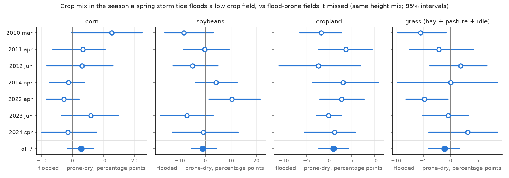

# Storm panel: crop mix in the season a spring storm tide floods a field

Generated by `plot_storm_panel.py` (for reference only: it needs our private package). Descriptive;
no regression.

**Flooded** means at least 10% of the field under more than 5 cm in the flood model. Runs use rebuilt
creek channels, NOAA gauge water levels, and wind: a 3 km analysis from 2016, and before that a coarser
reanalysis scaled up 30% that still reads low at storm peaks. So the 2010-14 and 2022-24 storms are not
forced alike. Peak water was compared with creek gauges only for 2018-25, so the 2010-14 storms are
unchecked on this version. Where checked, peaks are mostly within 0.2 m (usually high near Bivalve, low
in the Alloway), which matters on flat fields. More fields flood than on the earlier version, and we
have not yet explained why.

**Fields:** 891 low crop fields (farmed in NJDEP's 2012 land-use map, < 1.5 m above average
higher high tide, at least half cropland 2008-12), not flooded by ordinary spring tides in the model.
On the storm tide alone, 435 are flooded by at least one of the 18 modelled storm tides;
456 by none. These are map polygons, not farms: most are small, and the estimates are
weighted by area, so a few large fields count for much.

**Comparison:** in each spring-storm year, the fields that storm floods (storm tide alone) against
"prone-dry" fields, which flood in other modelled storm tides but not this one, weighted to the
same mix of field heights. Each field's share is measured against its own mean in nearby quiet
years (2008, 2009, 2015, 2017, 2018, 2020, 2025; within 5 years, never the outcome year itself). A quiet year has no modelled spring storm and no
flood from the July before through February: autumn or late-summer storms after that year's
planting do not count against it. Numbers are percentage points of field area, flooded minus
comparison, with 95% intervals from resampling fields. Crop-share signs flip between storms. In the
per-storm table, 3 of 28 storm-and-crop results exclude zero, against about 1.4 expected by chance
(results are not independent; no formal test).

## Same season, per storm (tide only, vs prone-dry)

`eff_` columns are the effective number of fields once area weights are counted (Kish): a few large
fields carry each group, so the groups behave as far fewer fields than their counts.

| storm | n_flooded | eff_flooded | n_comparison | eff_comparison | corn | soybeans | cropland | grass (hay + pasture + idle) |
|---|---|---|---|---|---|---|---|---|
| storm2010mar | 113 | 8 | 322 | 22 | +12.7 [-0.3, +22.4] | -8.4 [-15.9, +3.2] | -1.8 [-6.5, +2.8] | -5.5 [-9.7, -0.9] |
| storm2011apr | 354 | 36 | 81 | 14 | +3.4 [-6.3, +10.5] | -0.3 [-8.6, +9.3] | +3.7 [-2.4, +9.5] | -2.1 [-7.6, +4.2] |
| storm2012jun | 152 | 12 | 283 | 25 | +3.1 [-8.3, +13.1] | -5.1 [-12.7, +4.9] | -2.4 [-11.1, +7.0] | +1.8 [-3.9, +6.7] |
| storm2014apr | 169 | 15 | 266 | 24 | -1.2 [-7.5, +4.0] | +4.2 [-3.8, +12.4] | +3.0 [-3.6, +11.0] | +0.0 [-9.7, +8.6] |
| storm2022apr | 72 | 10 | 363 | 50 | -2.7 [-8.3, +2.3] | +10.4 [+1.4, +21.6] | +2.7 [-2.1, +7.7] | -4.8 [-8.2, -0.5] |
| storm2023jun | 161 | 13 | 274 | 29 | +5.9 [-3.6, +14.9] | -7.3 [-17.7, +3.0] | -0.1 [-2.8, +2.7] | -0.5 [-5.0, +3.2] |
| storm2024spr | 249 | 25 | 186 | 13 | -1.5 [-9.9, +7.9] | -0.8 [-13.0, +12.8] | +1.2 [-5.5, +5.8] | +3.1 [-4.0, +8.6] |
| all |  |  |  |  | +2.8 [-1.7, +6.7] | -1.0 [-5.3, +4.3] | +0.9 [-2.2, +4.3] | -1.1 [-4.0, +1.6] |

## All 7 storms, the variants

k = 0: the season of the storm; k = 1: the next season. "never" = fields no modelled storm tide
floods on its own (weighted to the same heights; 208 of these 456 flood when rain is counted).
"rain" = flooded counting the storm's rain. "incl. chronic" = the
152 fields wet on ordinary spring tides put back (125 of them flood in all 18 storm tides, so
they are almost always in the flooded group).

| flooded by | comparison | k | corn | soybeans | cropland | grass (hay + pasture + idle) |
|---|---|---|---|---|---|---|
| rain | never | 0 | +1.4 [-1.6, +4.4] | -1.1 [-5.0, +2.8] | -0.2 [-2.4, +2.2] | -0.5 [-3.0, +1.4] |
| rain | never | 1 | +0.2 [-2.5, +3.5] | -0.2 [-5.6, +5.3] | -3.2 [-6.4, -0.3] | +1.4 [-0.8, +3.4] |
| rain | prone-dry | 0 | +1.5 [-3.0, +4.9] | -0.7 [-4.9, +4.3] | +0.6 [-2.3, +3.7] | -0.8 [-3.3, +1.6] |
| rain | prone-dry | 1 | +0.6 [-3.2, +4.0] | +2.1 [-3.1, +8.0] | +0.2 [-3.4, +3.3] | +1.1 [-1.5, +3.9] |
| tide | never | 0 | +2.3 [-0.7, +5.4] | -0.8 [-5.4, +4.0] | -0.2 [-2.6, +2.7] | -0.9 [-3.6, +1.3] |
| tide | never | 1 | +0.6 [-2.4, +4.2] | -1.7 [-7.0, +3.6] | -3.4 [-6.8, -0.4] | +1.8 [-0.8, +3.9] |
| tide | never, incl. chronic | 0 | +0.9 [-1.8, +3.8] | +1.1 [-2.6, +4.9] | -0.8 [-2.7, +1.5] | -1.8 [-3.9, +0.2] |
| tide | never, incl. chronic | 1 | -1.4 [-4.0, +1.7] | -0.4 [-4.2, +3.3] | -4.4 [-6.9, -2.0] | +0.4 [-1.8, +2.3] |
| tide | prone-dry | 0 | +2.8 [-1.7, +6.7] | -1.0 [-5.3, +4.3] | +0.9 [-2.2, +4.3] | -1.1 [-4.0, +1.6] |
| tide | prone-dry | 1 | +0.8 [-2.7, +4.0] | +0.8 [-4.3, +6.5] | -0.3 [-4.1, +3.0] | +1.7 [-1.1, +4.7] |
| tide | prone-dry, incl. chronic | 0 | -0.3 [-3.8, +3.4] | +1.8 [-1.9, +6.1] | +0.5 [-2.1, +3.1] | -1.8 [-4.0, +0.5] |
| tide | prone-dry, incl. chronic | 1 | -1.3 [-4.3, +1.8] | +2.4 [-1.8, +6.6] | -0.9 [-3.9, +1.7] | +0.7 [-2.2, +3.5] |

Next-season cropland against never-flooded fields is -3.4 [-6.8, -0.4]. We have not explained this, and it
is not a stable number. USDA changed how it makes the crop map in 2024. With 2024 and later removed from both
outcomes and baselines (table below; tide only; 5 storms) it is -3.4 [-6.7, -0.3], or
-5.1 [-7.5, -2.4] counting every field once. The 7-storm and 5-storm figures are different pools that happen to
agree. Leaving one storm out of the 5: without 2010, -2.9 [-6.0, +0.5]; without 2011, -3.5 [-7.1, -0.1]; without 2012, -3.6 [-6.4, -0.5]; without 2014, -4.5 [-8.4, -0.7]; without 2022, -2.5 [-6.3, +0.4]. Against prone-dry fields it spans zero.

| comparison | k | corn | soybeans | cropland | grass (hay + pasture + idle) |
|---|---|---|---|---|---|
| prone-dry | 0 | +3.3 [-2.2, +7.3] | -0.9 [-5.3, +4.2] | -0.0 [-3.4, +3.7] | -1.1 [-4.1, +2.0] |
| prone-dry | 1 | +0.2 [-4.0, +4.2] | -2.1 [-6.5, +3.3] | -2.1 [-5.6, +1.1] | +1.7 [-2.3, +5.3] |
| never | 0 | +3.2 [-0.7, +7.3] | -2.7 [-6.9, +2.3] | -1.5 [-4.2, +1.8] | +0.2 [-2.5, +2.5] |
| never | 1 | -0.0 [-3.7, +3.9] | -3.8 [-8.4, +1.3] | -3.4 [-6.7, -0.3] | +3.0 [-0.6, +5.8] |

The 7-storm rows above keep 2024-on baseline years for the 2022-24 storms, and the 2024 storm cannot avoid
straddling the change, so this table is the safer reading of those rows.

**Every field counted once** instead of by area (still matched on height; flooded - prone-dry, tide only):

| outcome | k = 0 | k = 1 |
|---|---|---|
| corn | +1.6 [-1.5, +4.6] | +2.1 [-1.2, +5.3] |
| soybeans | +0.9 [-2.7, +4.5] | -1.3 [-4.5, +2.2] |
| cropland | +0.1 [-2.4, +2.6] | -2.8 [-5.7, +0.2] |
| grass (hay + pasture + idle) | -3.8 [-7.0, -1.0] | -1.1 [-3.8, +1.6] |
| main crop changed | +5.7 [+0.3, +11.9] | +0.7 [-4.8, +7.3] |
| left cropland | +0.1 [-1.9, +2.2] | +0.7 [-2.1, +3.3] |
| left farmland | -0.6 [-2.6, +1.2] | +0.8 [-1.3, +2.7] |

Some differences grow when every field counts equally, and same-season grass and main crop changed then
exclude zero, so the area-weighted result rests partly on a few large fields.

## Yes/no per field: did it change crop, did it leave cropland?

Same comparison, with a yes/no outcome per field instead of a share: **main crop changed** (the
field's largest land use differs from the year before), **left cropland** (at least half
cropland the year before, under half that year and the next) and **left farmland** (the same on
cropland + pasture). Numbers are percentage points of
the chance, flooded minus comparison. Outcome years from 2024 on are left out (USDA's crop-map
change), and 2023 too for the two left outcomes, whose flag reads the next year's map. Pooled rows use, for k = 0
and k = 1, 6 and 5 storms (main crop changed), 5 and 4 (left cropland).
Usual yearly rates on the flood-prone fields in quiet years: main crop changed 53%, left cropland 1%, left farmland 1%.

| flooded by | comparison | k | main crop changed | left cropland | left farmland |
|---|---|---|---|---|---|
| rain | never | 0 | +20.8 [+3.0, +35.8] | -1.1 [-3.5, +1.0] | -0.9 [-2.9, +0.7] |
| rain | never | 1 | +8.2 [-5.3, +19.7] | +0.6 [-4.4, +6.1] | +0.4 [-0.3, +1.2] |
| rain | prone-dry | 0 | +19.9 [+2.1, +35.5] | -0.7 [-2.7, +1.1] | -0.7 [-2.7, +0.8] |
| rain | prone-dry | 1 | +9.7 [-7.1, +22.7] | -2.0 [-7.1, +3.4] | -1.4 [-4.6, +0.5] |
| tide | never | 0 | +21.1 [-1.6, +38.2] | -1.4 [-4.0, +1.0] | -1.3 [-3.6, +0.7] |
| tide | never | 1 | +9.3 [-4.4, +21.0] | +0.6 [-4.5, +6.2] | +0.2 [-0.4, +0.9] |
| tide | never, incl. chronic | 0 | +18.8 [+1.2, +32.3] | +0.6 [-1.3, +2.7] | +0.5 [-1.1, +2.3] |
| tide | never, incl. chronic | 1 | +11.8 [+0.2, +21.6] | +0.8 [-3.5, +5.5] | +0.9 [+0.1, +2.2] |
| tide | prone-dry | 0 | +17.8 [-1.9, +33.9] | -1.3 [-3.7, +0.9] | -1.3 [-3.6, +0.5] |
| tide | prone-dry | 1 | +7.6 [-8.3, +20.3] | -1.4 [-5.7, +3.9] | -1.4 [-4.1, +0.1] |
| tide | prone-dry, incl. chronic | 0 | +14.7 [-1.6, +28.5] | +0.5 [-1.3, +2.3] | +0.5 [-1.0, +2.4] |
| tide | prone-dry, incl. chronic | 1 | +5.8 [-6.9, +17.5] | -1.4 [-5.7, +2.7] | -0.9 [-3.8, +1.3] |

Left cropland is -1.3 [-3.7, +0.9] the same season and -1.4 [-5.7, +3.9] the next; left farmland -1.3 [-3.6, +0.5] and -1.4 [-4.1, +0.1], by area against
flood-prone comparison fields. Neither flag means the field stopped farming (over half of flags come back). With every field
counted once, next-season exits against never-flooded fields read slightly higher: left cropland +2.1 [+0.04, +4.2], left
farmland +1.6 [+0.06, +3.2] (`sensitivity.csv`). Among many rows, two barely excluding zero is weak evidence, but they sit
beside the next-season cropland gap. Not a finding.

## The chronic fields over time

The 152 low crop fields where the model puts ordinary spring tides on at least 10% of the field in
one simulated month (October 2024 with wind, today's dikes) are left out above. This may be partly a
model artefact: they are small, and on the older version many were a couple of wet days on the low part
of a marsh-edge field, where a 100 m model cannot see berms or ditches. The group grew from 100 to 152
with this model version. Whether storms caused their wetness is untested. Their cropland, minus other
fields reweighted to the same heights (percentage points of field area, by CDL year):

| chronic minus | 2008 | 2009 | 2010 | 2011 | 2012 | 2013 | 2014 | 2015 | 2016 | 2017 | 2018 | 2019 | 2020 | 2021 | 2022 | 2023 | 2024 | 2025 |
|---|---|---|---|---|---|---|---|---|---|---|---|---|---|---|---|---|---|---|
| flood-prone | -4 | -6 | -4 | -8 | -9 | -3 | -9 | -9 | -8 | -9 | -9 | -9 | -8 | -8 | -9 | -10 | -10 | -14 |
| never flooded | -5 | -10 | -7 | -14 | -10 | -12 | -12 | -10 | -10 | -9 | -10 | -15 | -15 | -15 | -16 | -16 | -34 | -32 |

Against flood-prone fields the gap averages -4 in 2008-10 and -9 in 2015-2023.
Against never-flooded fields it widens at 2019 (cause unclear: CDL, weather or the 2018 storms) and at
USDA's 2024 change in the crop map, which hit wet low ground hardest; earlier years are noisy.

Put back into the storm comparison (rows "incl. chronic" above), they move the pooled same-season
result on corn from +2.8 to -0.3 and on soybeans from -1.0 to +1.8 percentage points. 125 of them flood
in every storm tide and so sit in the flooded group of every storm, so this is partly one group's
storm years against its quiet years, not seven tests. This cannot say WHY: the model has today's banks for every
year, and the chronic fields sit lower on average than the comparison fields.

## Caveats

- **Not detectable is not "no effect".** "Flooded" is a model result, noisy field by field, which
  pulls differences toward zero. Its flooded area has not been checked against satellite images on
  this version; on an older version Landsat confirmed only a small part of the model's water at
  overpass (mostly one informative storm, April 2011). CDL is USDA's satellite estimate of the crop, noisy
  on small fields; it does not measure yield or salt damage.
- **The model moves surface water only:** no salt, groundwater, crop or marsh processes, so "flooded"
  does not mean salt damage. Gate sizes are assumed (no public inventory).
- **The groups differ in more than this year's flood.** Flooded groups are repeat-flood fields: on
  average they flood in 11-17 of the 18 storm tides, the comparison fields in 2-8. The
  quiet-year baseline removes their usual crop mix, not a different trend.
- **"Missed" means missed by this storm.** Share flooded in the months before, comparison fields: 2010: 0%, 2011: 0%, 2012: 7%, 2014: 0%, 2022: 90%, 2023: 0%, 2024: 46%.
  Flooded fields: 2010: 0%, 2011: 0%, 2012: 83%, 2014: 0%, 2022: 96%, 2023: 0%, 2024: 98%. So 2012 and 2024 partly test the earlier storm, and 2022's comparison
  fields had nearly all just flooded. 4 of 7 storms have another spring storm the next season, so
  "next season" is not recovery from one flood.
- **Selection.** Fields must be at least half cropland in 2008-12, a window holding the 2010-12 storms,
  so fields that left early are screened out.
- **CDL year = the summer crop.** March-April storms come before or during planting; early-June storms
  (2012, 2023) during or after it (dates approximate, not checked against local crop calendars).
- **Unmodelled storms.** Storms are picked from our Ship John series, gauge plus estimates where it was
  out (2008-09, 2021); heights are uncertain by about 0.1 m. Storm tides below 1.68 m are not modelled, and the
  quiet years 2015, 2017, 2020 and 2025 hold tides of 1.61-1.64 m. A tide just above the line (March 2010)
  floods a quarter of the flood-prone fields, so these may be wet too. Quiet 2008 may be one as well: the
  gauge stops at the crest of May 12, when other bay gauges read higher than in March 2010.
- **"Main crop changed" is not a finding yet.** It reads higher on flooded fields in 6 of 6 storms, +18
  [-2, +34] by area (+5.7 [+0.3, +11.9] if every field counts once), but it changes a lot with the
  2-4 baseline years each storm has. On the storms with both (2014, 2022), it is -1 points against even
  quiet years and +16 against odd ones, with some storms resting on one baseline year on a side; with no
  baseline, +9.5 over the storms before 2024. The same-season with-rain rows and two "never, incl. chronic" rows exclude
  zero, but "never" rows rest on as few effective fields as prone-dry rows (11-38 vs 13-50 per storm), so lean on neither. Possibly rotation, and on the older
  version some of the switch was to CDL "wetland", perhaps standing water in that summer's image. The yearly
  rate also shifts between eras (higher up to 2015).
- **Dikes as they stand today in the model**, for every year: mapped from lidar, not surveyed.
- **Seven storms, mostly the SAME fields.** The "all" interval resamples fields and holds the seven
  storms fixed, so it leaves out year-to-year differences and may be too narrow.
